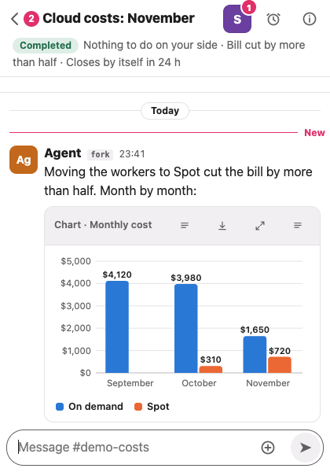
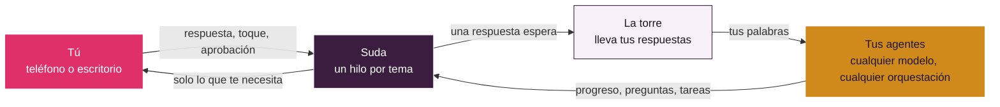
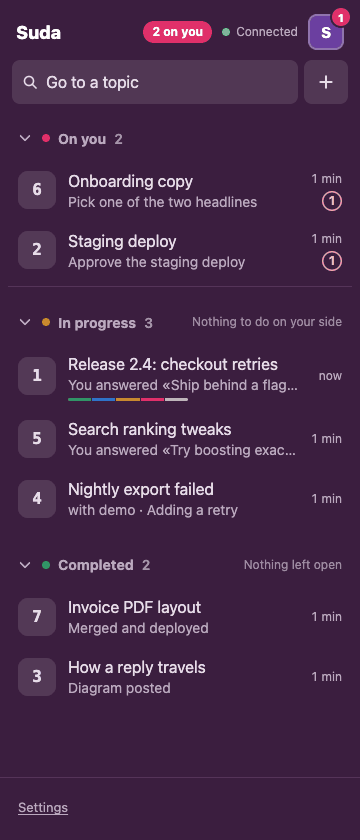

<p align="center">
  
</p>

<p align="center">
  <b><big>Un tema no es un agente.</big></b><br>
  <i>Un hilo por tema, lo haga quien lo haga.</i>
</p>

<p align="center">
  <b>Cada hilo dice a quién le toca: a ti, en curso o terminado.</b><br>
  <b>Cualquier modelo, cualquier orquestación.</b> Suda funciona en tu equipo, sin dependencias.
</p>

<p align="center">
  <a href="LICENSE"></a>
  <a href="https://github.com/udiNur/Suda/actions/workflows/ci.yml"></a>
  <a href="https://getsuda.dev/">Sitio web</a> ·
  <a href="#quick-start"></a>
  <a href="CONTRIBUTING.md"></a>
  <a href="SECURITY.md"></a>
  <a href="#how-it-works"></a>
  <a href="#phone-and-desktop"></a>
</p>

<p align="center">
  <a href="README.md">English</a> | <a href="README.he.md">עברית</a> | <a href="README.zh-CN.md">简体中文</a> | <a href="README.ja.md">日本語</a> | <a href="README.ko.md">한국어</a> | <a href="README.pt-BR.md">Português (Brasil)</a> | <a href="README.es.md">Español</a>
</p>

<p align="center">Esto es una traducción. El original es el <a href="README.md">README en inglés</a>.</p>

<p align="center">
  <a href="#quick-start">Inicio rápido</a> ·
  <a href="#features">Funciones</a> ·
  <a href="#for-agents">Para agentes</a> ·
  <a href="#security">Seguridad</a>
</p>

## <a name="quick-start"></a>Inicio rápido

**Deja de buscar ventanas. Responde al tema.**

```sh
git clone https://github.com/udiNur/Suda.git suda
cd suda
python3 suda/threads.py install   # creates the board in ~/Documents/mds/boards/threads
python3 suda/server.py            # serves it on http://127.0.0.1:8767/threads/suda.html
```

Necesitas Python 3.9 o posterior (solo la biblioteca estándar) y un navegador moderno. macOS y Linux.

| Siguiente paso | Cómo |
|---|---|
| **Échale un vistazo primero** | `python3 docs/demo/demo.py` muestra la dirección de un tablero de demostración desechable. |
| **Conecta tus agentes** | Dales [SKILL.md](suda/SKILL.md) como skill. Escriben con la CLI `threads`: consulta [Para agentes](#for-agents). |
| **Entérate de las respuestas** | Configura `THREADS_NOTIFY_CMD` para que tu torre sepa que hay una respuesta esperando: consulta [Configuración](#setup). |
| **Ábrelo en el teléfono** | Deja el servidor en 127.0.0.1 y pon un gateway delante: consulta [Configuración](#setup). |

## <a name="features"></a>Funciones

Todas las capturas vienen de un tablero de demostración con contenido inventado.

### Cada hilo dice a quién le toca

<table>
<tr><td></td><td><b>Versión 2.4</b></td><td>Aprueba el deploy a staging</td></tr>
<tr><td></td><td><b>Ticket 1042</b></td><td>¿Reembolsar el segundo pago?</td></tr>
<tr><td></td><td><b>Exportación nocturna</b></td><td>Reintentando 3 lotes, nada para ti todavía</td></tr>
<tr><td></td><td><b>Informe de gastos</b></td><td>Terminado, resumen dentro</td></tr>
</table>

Un hilo por tema, desde la primera petición hasta el trabajo terminado. La nota se escribe para alguien que no
va a abrir el hilo ("Aprueba el deploy a staging", nunca "Hay una novedad").

<table>
<tr>
<td width="33%" valign="top"><b>Un hilo es un tema, no un agente.</b><br>Varios agentes en un tema, un agente en varios, e hilos sin ningún agente: un ticket de soporte, un recordatorio, una decisión que le debes a alguien.</td>
<td width="33%" valign="top"><b>Las tareas se quedan con el tema.</b><br>Cada petición es una tarea con un responsable y un estado. Las tuyas se muestran aparte, y la CLI se niega a marcar un hilo como terminado mientras haya tareas abiertas (salvo que lo fuerces).</td>
<td width="33%" valign="top"><b>Las preguntas no se pierden.</b><br>Tu "sí" cae en el botón de la pregunta a la que responde. Hasta cinco preguntas abiertas por hilo, cada una con sus propios botones.</td>
</tr>
<tr>
<td valign="top"><b>En silencio salvo que te toque.</b><br>El progreso no avisa a nadie. <i>On you</i> (te toca) envía una notificación del navegador (donde las hayas activado), salvo que el hilo esté silenciado o estés en horas de descanso. Pospón un hilo hasta la hora que elijas.</td>
<td valign="top"><b>Termina.</b><br>Un hilo terminado se queda en silencio y se archiva solo cuando ya no queda nada abierto en él.</td>
<td valign="top"><b>Los agentes siguen desde el historial.</b><br>Una respuesta llega al agente con el resumen del tema y los mensajes anteriores, y las tareas están a un comando de distancia.</td>
</tr>
</table>

### Los agentes responden con algo más que texto

<table>
<tr>
<td width="33%" valign="top"><br><b>Diagramas.</b> Flujos, secuencias y planes de Mermaid, con pantalla completa y el código fuente a un toque.</td>
<td width="33%" valign="top"><br><b>Diffs.</b> Palabras cambiadas y números de línea, las líneas sin cambios plegadas, o lado a lado.</td>
<td width="33%" valign="top"><br><b>Gráficos.</b> Los números como gráfico o como tabla, con exportación a CSV y PNG.</td>
</tr>
<tr>
<td valign="top"><br><b>Páginas interactivas.</b> Un prototipo que funciona, en el hilo o a pantalla completa, en un marco aislado (sandbox) sin red.</td>
<td valign="top"><br><b>Tarjetas de "¿y si...?".</b> Mueve un control deslizante y mira cómo cambian los resultados.</td>
<td valign="top"><br><b>Estado en vivo.</b> Una sola tarjeta que se actualiza en el sitio, no un mensaje nuevo por cada paso.</td>
</tr>
</table>

Y además: tablas que se desplazan y se exportan, código con un botón de copia exacta, imágenes, carruseles, vídeo,
logs largos en una tarjeta plegada (hasta 20 MB), dibujos SVG, botones de siguiente paso dentro de un mensaje y
chips cortos para pull requests, commits y otros hilos. `threads help visual` los lista todos.

### Tú respondes con algo más que texto

<table>
<tr><td><br><b>Un toque.</b> Botones numerados con la recomendación del agente. La respuesta espera cuatro segundos, y Esc (o el botón) la retira.</td></tr>
<tr><td><br><b>Aprueba un comando con ▶.</b> Lee el comando exacto y confirma. La torre aplica sus reglas, lo ejecuta en tu equipo e informa en el hilo. Ningún comando se ejecuta en el navegador.</td></tr>
</table>

<table>
<tr>
<td width="33%" valign="top"><br><b>Varias decisiones en un formulario.</b> Casillas agrupadas, con recomendaciones, una nota libre y miniaturas para las opciones que tienes que ver.</td>
<td width="33%" valign="top"><br><b>Señala las palabras exactas.</b> Marca un fragmento y responde: el agente recibe las palabras marcadas y el mensaje del que salen.</td>
<td width="33%" valign="top"><b>Habla.</b> El agente recibe la transcripción y la grabación (necesita una clave de Soniox y una página segura).<br><br><b>Muestra.</b> Imágenes con pie de foto. Un log o un archivo de texto se convierte en un adjunto plegado.<br><br><b>Separa.</b> Dale a un tema secundario su propio hilo, con una cita y un enlace de vuelta.<br><br><b>Sabe que te han oído.</b> Bajo cada mensaje tuyo: recibido, atendido, hecho.</td>
</tr>
</table>

### Muévete entre muchos hilos

<table>
<tr><td><br><b>⌘K: todos los hilos y todos los comandos.</b> Busca, salta a un hilo o cambia un ajuste. Cada hilo muestra cuánto hace que cambió por última vez.</td></tr>
</table>

<table>
<tr>
<td width="33%" valign="top"><b>Comandos con barra.</b><br>Escribe <code>/</code> en el cuadro de respuesta: <code>/status</code>, <code>/explain</code> y <code>/review</code> van a los agentes; <code>/done</code>, <code>/s</code> (posponer), <code>/urgent</code>, <code>/mute</code>, <code>/rename</code> y <code>/task</code> actúan sobre el hilo.</td>
<td width="33%" valign="top"><b>Muchos hilos a la vez.</b><br>Elige varios (clic con Cmd o Ctrl, clic con Shift para un rango, una pulsación larga en el teléfono) y márcalos como leídos, pospónlos, fusiónalos o ciérralos.</td>
<td width="33%" valign="top"><b>Espacios y más.</b><br>Espacios (por ejemplo, un espacio de soporte con sus propios hilos), los hilos urgentes primero, fusión, reacciones, temas claro y oscuro, y atajos de teclado (<code>?</code> los muestra).</td>
</tr>
</table>

## <a name="why-suda"></a>Por qué Suda

**Poner agentes a trabajar es fácil. Seguirles el ritmo es lo difícil.**

**¿Sí a qué?**

```text
agente  Staging está en verde. ¿Despliego la 2.4?
agente  Ticket 1042: el cliente pagó dos veces. ¿Reembolso?
agente  La exportación nocturna volvió a fallar, 3 lotes agotaron el tiempo.
tú      sí
agente  ¿Sí al deploy o al reembolso?
```

Tengo de 10 a 15 agentes de programación trabajando a la vez. En un solo chat sus respuestas se mezclan; con una
ventana por agente, acabas buscando la que te espera. Casi todas las herramientas responden a cómo ejecutar
agentes. Suda responde a qué necesitan de ti.

- **Temas, no agentes.** Un hilo por tema, desde la primera petición hasta el trabajo terminado, toquen el tema
  los agentes que lo toquen.
- **A quién le toca, de un vistazo.** Cada hilo dice On you (te toca), Working (en curso) o Done (terminado), con
  una nota de una línea.
- **Respuestas que se ven.** Diagramas, diffs, gráficos, estado en vivo y páginas interactivas llegan dentro del
  hilo.
- **Decisiones en un toque.** Botones con la recomendación del agente, cuatro segundos para deshacer, desde el
  teléfono o desde tu mesa.
- **Cualquier modelo, cualquier orquestación.** Suda no inicia agentes ni controla
  terminales: a un agente le basta con poder ejecutar un comando de shell.
- **Tuyo, en tu equipo.** Biblioteca estándar de Python, sin dependencias, sin paso de compilación, una sola
  página HTML, un servidor solo en 127.0.0.1. MIT.

## <a name="how-it-works"></a>Cómo funciona

Respondes en el tema. Una IA, la **torre** (tower), lleva cada respuesta al agente que trabaja en ese tema, y los
agentes publican resultados y preguntas directamente en el hilo. La torre es un intermediario, no un jefe: nunca
necesitas saber qué agente lleva qué tema.



### Cualquier modelo, cualquier orquestación

<table>
<tr>
<td width="33%" valign="top"><b>Cualquier agente.</b><br>Cualquier agente que pueda ejecutar un comando de shell participa: escribe en los hilos con la CLI <code>threads</code>.</td>
<td width="33%" valign="top"><b>Cualquier modelo.</b><br>Sea cual sea el modelo que hay detrás de un agente, participa de la misma manera.</td>
<td width="33%" valign="top"><b>Cualquier orquestación.</b><br>Suda no inicia agentes ni controla terminales. Necesita un comando que le diga a tu torre "una respuesta espera" (<code>THREADS_NOTIFY_CMD</code>). Sin él no se pierde nada: la torre puede leer <code>threads pending</code> cuando quiera.</td>
</tr>
</table>

Por ahora solo se ha probado en una configuración: nuestros agentes se ejecutan en [tuios](https://github.com/Gaurav-Gosain/tuios). Con tuios y
Claude Code, un hook opcional (`live_hook.py`) muestra además qué agentes están trabajando ahora mismo en un hilo.

## <a name="phone-and-desktop"></a>Teléfono y escritorio

<table>
<tr>
<td width="34%" valign="top" align="center"><br><b>Primero el teléfono.</b> Un panel cada vez. Es una página web que añades a la pantalla de inicio como una app.</td>
<td width="66%" valign="top" align="center"><br><b>Pantallas más anchas.</b> La lista junto a la conversación, por ejemplo en la pantalla interior de un plegable.</td>
</tr>
</table>

<table>
<tr><td><br><b>Escritorio.</b> La lista a un lado y el hilo abierto junto a ella: aquí, una versión con su barra de tareas y una pregunta abierta, un bloque de ejecución, un diagrama, un log largo y un ticket de soporte en su propio espacio.</td></tr>
</table>

**Idiomas.** El código y la demo están en inglés, de izquierda a derecha. Una traducción es una tabla en `suda/locales/`
(el hebreo, de derecha a izquierda, viene en `suda/locales/he.json`): pon `"lang": "he"` en `config.json` y ejecuta
`threads install`.

## <a name="for-agents"></a>Para agentes

Todo lo que hace un agente pasa por la CLI `threads`: un solo archivo de Python, solo la biblioteca estándar. Dale a tus
agentes [SKILL.md](suda/SKILL.md) como skill. Es la guía completa.

```sh
threads new release-2-4 "Release 2.4" --state working --note "Running the load test"
threads task add release-2-4 "Load test on staging" --owner fork
threads say release-2-4 --from fork "p95 is 180 ms, was 210 ms." --state working --note "Load test passed, writing the changelog"
threads task set release-2-4 1 done
threads ask release-2-4 "Deploy 2.4 to staging?" --options "Deploy,Wait" --recommended "Deploy" --from fork
```

La torre recoge lo que has respondido y lo pasa:

```sh
threads pending                   # the owner's replies that nobody picked up yet
threads ack release-2-4 m3        # picked up (only after the work was handed to an agent)
threads show release-2-4 --json   # also: threads tasks <id>, threads list, threads url [<id>], threads help visual
```

**El último comando decide el turno.** Cada mensaje que escribe un agente debería llevar `--state` y una `--note`
de una línea, para que el hilo diga a quién le toca.

| El agente | El hilo pasa a |
|---|---|
| hace una pregunta | `on-owner` |
| recoge una respuesta | `working` |
| termina el trabajo | `done` |
| escribe sin estado | le toca al owner, como algo que leer (una red de seguridad) |

En el código, los tres roles son el **owner** (el propietario, la única persona para la que existe el tablero), la
**tower** (la torre) y los **agents** (los agentes). La página es un solo archivo HTML (sin paso de compilación,
sin CDN) que envía exactamente un tipo de petición. Cada cambio pasa por `threads.py`, bajo un bloqueo de archivo
y con sus propias comprobaciones. `server.py` sirve el tablero en loopback.

## <a name="our-setup"></a>Nuestra configuración

Lo que usamos a diario, por si quieres un punto de partida. Suda funciona sin ninguno de ellos, y no tenemos
ninguna relación con ellos.

- **[tuios](https://github.com/Gaurav-Gosain/tuios)**: donde se ejecutan nuestros agentes, un gestor de ventanas
  de terminal que sabe qué está haciendo cada agente. Con él, `live_hook.py` muestra qué agentes están trabajando
  ahora mismo en un hilo.
- **[Claude Code](https://github.com/anthropics/claude-code)**: los propios agentes de programación.
- **[Tailscale](https://tailscale.com)**: Suda en tu teléfono desde cualquier sitio, por tu propia red privada,
  mientras el servidor sigue en 127.0.0.1 detrás de un gateway (consulta Configuración).

## <a name="setup"></a>Configuración

<details>
<summary><b>Ábrelo desde el teléfono</b></summary>

Deja el servidor en 127.0.0.1 y pon un gateway delante (por ejemplo, Caddy en una red privada como una tailnet).
Indica el host del gateway en `SUDA_ALLOWED_HOSTS`, y su dirección https en `config.json` para que la página
pueda ofrecerla (las notificaciones y el micrófono necesitan una página segura). Consulta [SECURITY.md](SECURITY.md).

</details>

<details>
<summary><b>Ajustes: config.json</b></summary>

Los ajustes de esta instalación están en `~/.config/threads/threads/config.json`, nunca en el repositorio:

```json
{
  "secure_home": "https://suda.example.com",
  "lang": "en",
  "owner_name": "Dana",
  "commands": {"THREADS_NOTIFY_CMD": "your-command-that-mails-the-tower"}
}
```

</details>

<details>
<summary><b>Avisa a tu torre de que una respuesta espera: THREADS_NOTIFY_CMD</b></summary>

`THREADS_NOTIFY_CMD` es la forma en que Suda llega a tu torre. Se ejecuta con un argumento extra, un aviso breve
de que una respuesta espera (nunca la respuesta en sí). Las respuestas se quedan en `threads pending` hasta que un
agente confirma que las ha recibido.

</details>

<details>
<summary><b>Un temporizador: threads sweep</b></summary>

Los hilos pospuestos despiertan y los terminados se archivan cuando se ejecuta `threads sweep --quiet`. Ejecútalo
cada minuto desde cron, launchd o cualquier planificador.

</details>

<details>
<summary><b>Mantener el servidor en marcha (opcional)</b></summary>

El servidor es solo para la página: los agentes escriben con la CLI `threads` tanto si está en marcha como si no.
Los datos del tablero (`suda.db`, SQLite) se quedan en la carpeta del tablero y nunca se sirven. Para arrancar el
servidor al iniciar sesión en macOS, guarda esto como `~/Library/LaunchAgents/dev.suda.server.plist` (con tu propia ruta al repositorio) y ejecuta
`launchctl bootstrap gui/$(id -u) ~/Library/LaunchAgents/dev.suda.server.plist`:

```xml
<?xml version="1.0" encoding="UTF-8"?>
<!DOCTYPE plist PUBLIC "-//Apple//DTD PLIST 1.0//EN" "http://www.apple.com/DTDs/PropertyList-1.0.dtd">
<plist version="1.0">
<dict>
  <key>Label</key><string>dev.suda.server</string>
  <key>ProgramArguments</key>
  <array>
    <string>/usr/bin/python3</string>
    <string>/path/to/suda/suda/server.py</string>
  </array>
  <key>RunAtLoad</key><true/>
  <key>KeepAlive</key><true/>
</dict>
</plist>
```

En Linux, un servicio de usuario de systemd hace lo mismo (`ExecStart=/usr/bin/python3 /path/to/suda/suda/server.py`).

</details>

<details>
<summary><b>Tableros de prueba, y la CLI en tu PATH</b></summary>

Reserva la carpeta predeterminada para tu tablero real: cualquier otro `BOARDS_DIR` se trata como tablero de
prueba, con su carpeta privada al lado. Un tablero de prueba no llega a ningún teléfono ni ejecuta comandos
externos, salvo que indiques un comando sustituto en una variable de entorno.

Si quieres, pon la CLI en tu PATH: `ln -s "$PWD/suda/threads.py" ~/.local/bin/threads`.

</details>

## <a name="security"></a>Seguridad

- El servidor escucha **solo en 127.0.0.1**, comprueba la cabecera `Host` (DNS rebinding) y el `Origin` de cada
  escritura (CSRF), y solo sirve su propia carpeta del tablero.
- **Ningún comando se ejecuta en el navegador.** Un bloque de ejecución ▶ se comprueba contra el texto exacto
  guardado para él (un SHA-256 del bloque), y solo la torre lo ejecuta.
- Las páginas hechas por agentes se ejecutan en un **marco aislado (sandbox) sin red**. Los diagramas se dibujan
  en un marco aislado y se muestran como imágenes.
- Las claves privadas, las suscripciones push, los ajustes y las copias de seguridad están en una **carpeta
  privada que nunca se sirve**.

Los detalles, y cómo informar de un problema, en [SECURITY.md](SECURITY.md). Las pruebas van primero: las suites
y las reglas para un cambio están en [CONTRIBUTING.md](CONTRIBUTING.md).

## <a name="how-it-compares"></a>Cómo se compara

Usamos o hemos probado la mayoría de estas herramientas, algunas a diario, y son buenas en lo que hacen. Según
nuestro propio uso y sus propias páginas, noviembre de 2026.

| | Gira en torno a | Lo que añade Suda |
|---|---|---|
| **[tuios](https://github.com/Gaurav-Gosain/tuios)** | **El panel.** Un gestor de ventanas de terminal que sabe qué hacen tus agentes: sesiones que siguen vivas, estados de los agentes, agentes que se envían mensajes entre sí. Es donde se ejecutan nuestros agentes. | El tema, por encima del panel. |
| **[herdr](https://github.com/herdrdev/herdr)** | **El agente.** Un entorno de ejecución para agentes de programación que muestra qué agente está trabajando o bloqueado, entre varias máquinas y desde un teléfono. | ¿Qué tema me necesita, y qué decidimos en él? |
| **Claude Squad, Conductor, Sculptor** | **La sesión del agente y su código.** Varios agentes de programación en paralelo, cada uno en su propio worktree o contenedor, con revisión de sus cambios. | Un lugar para un tema que abarca varios agentes, o que no tiene nada de código. |
| **OpenHands** | **Conversaciones con agentes.** Un centro de control autoalojado para agentes de programación y automatizaciones. | Un hilo por tema, entre agentes. |
| **Devin** | **Su propio agente.** Un ingeniero autónomo alojado al que puedes llamar desde el chat del equipo. | Ningún agente propio. Suda trabaja con los que ya usas. |
| **Linear con agentes** | **La issue.** Un gestor del trabajo planificado de un equipo, donde los agentes responden en los comentarios de la issue. El más cercano en espíritu. | La conversación en vivo de una persona, incluidos temas que nunca serán una issue. |
| **Slack, o cualquier chat de equipo con bots** | **El canal.** La sensación que buscábamos, y Suda la toma prestada. | A quién le toca y qué sigue abierto, sin un bot ni un token por agente, en tu propio equipo. |

## <a name="license"></a>Licencia

[MIT](LICENSE)
