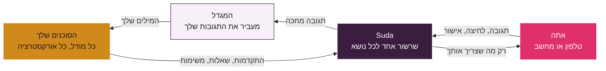

<p align="center">
  
</p>

<p align="center" dir="rtl">
  <b><big>נושא הוא לא סוכן.</big></b><br>
  <i>שרשור אחד לכל נושא, לא משנה מי עושה את העבודה.</i>
</p>

<p align="center" dir="rtl">
  <b>כל שרשור אומר של מי התור: עליך, בעבודה או הושלם.</b><br>
  <b>כל מודל, כל אורקסטרציה.</b> Suda רצה על המחשב שלך, בלי תלויות.
</p>

<p align="center">
  <a href="LICENSE"></a>
  <a href="https://github.com/udiNur/Suda/actions/workflows/ci.yml"></a>
  <a href="https://getsuda.dev/">אתר</a> ·
  <a href="#quick-start"></a>
  <a href="CONTRIBUTING.md"></a>
  <a href="SECURITY.md"></a>
  <a href="#how-it-works"></a>
  <a href="#phone-and-desktop"></a>
</p>

<p align="center">
  <a href="README.md">English</a> | <a href="README.he.md">עברית</a> | <a href="README.zh-CN.md">简体中文</a> | <a href="README.ja.md">日本語</a> | <a href="README.ko.md">한국어</a> | <a href="README.pt-BR.md">Português (Brasil)</a> | <a href="README.es.md">Español</a>
</p>

<p align="center" dir="rtl">זהו תרגום. המקור הוא <a href="README.md">ה-README באנגלית</a>.</p>

<p align="center" dir="rtl">
  <a href="#quick-start">התחלה מהירה</a> ·
  <a href="#features">יכולות</a> ·
  <a href="#for-agents">לסוכנים</a> ·
  <a href="#security">אבטחה</a>
</p>

## <a name="quick-start"></a>התחלה מהירה

**די לחפש חלונות. עונים בנושא.**

```sh
git clone https://github.com/udiNur/Suda.git suda
cd suda
python3 suda/threads.py install   # creates the board in ~/Documents/mds/boards/threads
python3 suda/server.py            # serves it on http://127.0.0.1:8767/threads/suda.html
```

נדרשים Python 3.9 ומעלה (הספרייה הסטנדרטית בלבד) ודפדפן עדכני. macOS ו-Linux.

<div dir="rtl">

| מה הלאה | איך |
|---|---|
| **קודם להציץ** | `python3 docs/demo/demo.py` מדפיס כתובת של לוח הדגמה חד-פעמי. |
| **לחבר את הסוכנים שלך** | נותנים להם את [SKILL.md](suda/SKILL.md) כ-skill. הם כותבים עם `threads`, ה-CLI של Suda: פרטים בסעיף [לסוכנים](#for-agents). |
| **להודיע למגדל על תגובות** | מגדירים את `THREADS_NOTIFY_CMD` כדי שהמגדל שלך יידע שתגובה מחכה: פרטים בסעיף [הגדרה](#setup). |
| **לפתוח בטלפון** | משאירים את השרת על 127.0.0.1 ושמים לפניו gateway: פרטים בסעיף [הגדרה](#setup). |

</div>

## <a name="features"></a>יכולות

כל צילומי המסך מגיעים מלוח הדגמה עם תוכן מומצא.

### כל שרשור אומר של מי התור

<div dir="rtl">
<table dir="rtl">
<tr><td></td><td dir="rtl"><b>גרסה 2.4</b></td><td dir="rtl">לאשר את הפריסה ל-staging</td></tr>
<tr><td></td><td dir="rtl"><b>פנייה 1042</b></td><td dir="rtl">להחזיר את התשלום השני?</td></tr>
<tr><td></td><td dir="rtl"><b>הייצוא הלילי</b></td><td dir="rtl">מנסה שוב 3 אצוות, בינתיים אין לך מה לעשות</td></tr>
<tr><td></td><td dir="rtl"><b>דוח עלויות</b></td><td dir="rtl">הסתיים, הסיכום בפנים</td></tr>
</table>
</div>

שרשור אחד לכל נושא, מהבקשה הראשונה ועד שהעבודה גמורה. ההערה נכתבת למי שלא יפתח את השרשור
("לאשר את הפריסה ל-staging", ולא "יש עדכון").

<table dir="rtl">
<tr>
<td dir="rtl" width="33%" valign="top"><b>שרשור הוא נושא, לא סוכן.</b><br>כמה סוכנים על נושא אחד, סוכן אחד בכמה נושאים, וגם שרשורים בלי סוכן בכלל: פניית תמיכה, תזכורת, החלטה שאתה חייב למישהו.</td>
<td dir="rtl" width="33%" valign="top"><b>המשימות נשארות עם הנושא.</b><br>כל בקשה היא משימה עם אחראי וסטטוס. המשימות שלך מוצגות בנפרד, וה-CLI מסרב לסמן שרשור כהושלם כל עוד יש בו משימות פתוחות (אלא אם כופים עליו).</td>
<td dir="rtl" width="33%" valign="top"><b>תשובה נשארת צמודה לשאלה.</b><br>ה"כן" שלך נוחת על הכפתור של השאלה שעליה הוא עונה. עד חמש שאלות פתוחות בשרשור, ולכל אחת הכפתורים שלה.</td>
</tr>
<tr>
<td dir="rtl" valign="top"><b>שקט, אלא אם התור שלך.</b><br>על התקדמות אף אחד לא מקבל התראה. <i>עליך</i> שולח התראת דפדפן (במכשירים שבהם הפעלת התראות), אלא אם השרשור מושתק או ששעות השקט פעילות. אפשר לשים שרשור בנודניק עד שעה לבחירתך.</td>
<td dir="rtl" valign="top"><b>יש לזה סוף.</b><br>שרשור שהסתיים משתתק, ועובר לארכיון מעצמו כשלא נשאר בו שום דבר פתוח.</td>
<td dir="rtl" valign="top"><b>הסוכנים ממשיכים מהכתוב.</b><br>תגובה מגיעה לסוכן יחד עם סיכום הנושא וההודעות הקודמות, והמשימות במרחק פקודה אחת.</td>
</tr>
</table>

### הסוכנים עונים ביותר מטקסט

<table dir="rtl">
<tr>
<td dir="rtl" width="33%" valign="top"><br><b>דיאגרמות.</b> תרשימי זרימה, רצפים ותוכניות ב-Mermaid, עם מסך מלא והקוד במרחק לחיצה.</td>
<td dir="rtl" width="33%" valign="top"><br><b>Diff.</b> המילים שהשתנו ומספרי השורות, שורות ללא שינוי מקופלות, או תצוגת צד לצד.</td>
<td dir="rtl" width="33%" valign="top"><br><b>גרפים.</b> המספרים כגרף או כטבלה, עם ייצוא ל-CSV ול-PNG.</td>
</tr>
<tr>
<td dir="rtl" valign="top"><br><b>דפים אינטראקטיביים.</b> דגם שעובד, בתוך השרשור או במסך מלא, במסגרת מבודדת (sandbox) בלי רשת.</td>
<td dir="rtl" valign="top"><br><b>כרטיסי "מה אם".</b> מזיזים סליידר ורואים את התוצאות משתנות.</td>
<td dir="rtl" valign="top"><br><b>סטטוס חי.</b> כרטיס אחד שמתעדכן במקום, ולא הודעה חדשה על כל צעד.</td>
</tr>
</table>

ועוד: טבלאות עם גלילה וייצוא, קוד עם כפתור העתקה מדויקת, תמונות, קרוסלות, וידאו, לוגים ארוכים בכרטיס
מקופל (עד 20 MB), תרשימי SVG, כפתורי "הצעד הבא" בתוך הודעה, ותגיות קצרות ל-pull requests, לקומיטים
ולשרשורים אחרים. הפקודה `threads help visual` מפרטת את כולם.

### גם אתה עונה ביותר מטקסט

<table dir="rtl">
<tr><td dir="rtl"><br><b>לחיצה אחת.</b> כפתורים ממוספרים עם ההמלצה של הסוכן. התשובה מחכה ארבע שניות, ו-Esc (או הכפתור) מבטל אותה.</td></tr>
<tr><td dir="rtl"><br><b>מאשרים פקודה עם ▶.</b> קוראים את הפקודה המדויקת ומאשרים. המגדל מחיל את הכללים שלו, מריץ אותה על המחשב שלך ומדווח בשרשור. שום פקודה לא רצה בדפדפן.</td></tr>
</table>

<table dir="rtl">
<tr>
<td dir="rtl" width="33%" valign="top"><br><b>כמה החלטות בטופס אחד.</b> תיבות סימון בקבוצות, עם המלצות, הערה חופשית, ואריחי תמונה לאפשרויות שצריך לראות.</td>
<td dir="rtl" width="33%" valign="top"><br><b>מצביעים על המילים המדויקות.</b> מסמנים קטע ומגיבים: הסוכן מקבל את המילים שסומנו ואת ההודעה שממנה הן הגיעו.</td>
<td dir="rtl" width="33%" valign="top"><b>לדבר.</b> הסוכן מקבל את התמלול ואת ההקלטה (צריך מפתח Soniox ודף מאובטח).<br><br><b>להראות.</b> תמונות עם כיתוב. לוג או קובץ טקסט הופכים לקובץ מצורף מקופל.<br><br><b>לפצל.</b> נותנים לעניין צדדי שרשור משלו, עם ציטוט וקישור חזרה.<br><br><b>לדעת ששמעו אותך.</b> מתחת לכל הודעה שלך: התקבל, נקלט, בוצע.</td>
</tr>
</table>

### לנוע בין הרבה שרשורים

<table dir="rtl">
<tr><td dir="rtl"><br><b><span dir="ltr">⌘K</span>: כל שרשור וכל פקודה.</b> מחפשים, קופצים לשרשור או משנים הגדרה. כל שרשור מראה לפני כמה זמן השתנה לאחרונה.</td></tr>
</table>

<table dir="rtl">
<tr>
<td dir="rtl" width="33%" valign="top"><b>פקודות לוכסן.</b><br>מקלידים <code dir="ltr">/</code> בתיבת התגובה: <code dir="ltr">/status</code>, <code dir="ltr">/explain</code> ו-<code dir="ltr">/review</code> הולכות לסוכנים; <code dir="ltr">/done</code>, <code dir="ltr">/s</code> (נודניק), <code dir="ltr">/urgent</code>, <code dir="ltr">/mute</code>, <code dir="ltr">/rename</code> ו-<code dir="ltr">/task</code> פועלות על השרשור.</td>
<td dir="rtl" width="33%" valign="top"><b>הרבה שרשורים בבת אחת.</b><br>בוחרים כמה (Cmd או Ctrl עם לחיצה, Shift עם לחיצה לטווח, לחיצה ארוכה בטלפון), ואז מסמנים כנקרא, שמים בנודניק, ממזגים או סוגרים.</td>
<td dir="rtl" width="33%" valign="top"><b>מרחבים ועוד.</b><br>מרחבים (למשל מרחב תמיכה עם שרשורים משלו), שרשורים דחופים ראשונים, מיזוג, תגובות אימוג'י, מראה בהיר וכהה, וקיצורי מקלדת (<code>?</code> מציג אותם).</td>
</tr>
</table>

## <a name="why-suda"></a>למה Suda

**להריץ סוכנים זה קל. לעמוד בקצב זה הקשה.**

**כן למה?**

<div dir="rtl">

```text
סוכן  ה-staging ירוק. לפרוס את 2.4?
סוכן  פנייה 1042: הלקוח שילם פעמיים. להחזיר לו את הכסף?
סוכן  הייצוא הלילי נכשל שוב, 3 אצוות נפלו על timeout.
אתה   כן
סוכן  כן לפריסה, או להחזר?
```

</div>

אני מריץ 10 עד 15 סוכני קוד במקביל. בצ'אט אחד התשובות שלהם מתערבבות; עם חלון לכל סוכן, מחפשים את זה
שמחכה לך. רוב הכלים עונים על השאלה איך להריץ סוכנים. Suda עונה על השאלה מה הם צריכים ממך.

- **נושאים, לא סוכנים.** שרשור אחד לכל נושא, מהבקשה הראשונה ועד שהעבודה גמורה, ולא משנה כמה סוכנים
  נוגעים בו.
- **של מי התור, במבט אחד.** כל שרשור אומר עליך, בעבודה או הושלם, עם הערה של שורה אחת.
- **תשובות שרואים בעיניים.** דיאגרמות, diffs, גרפים, סטטוס חי ודפים אינטראקטיביים מגיעים לתוך השרשור.
- **החלטה בלחיצה אחת.** כפתורים עם ההמלצה של הסוכן, ארבע שניות להתחרט, מהטלפון או מהשולחן.
- **כל מודל, כל אורקסטרציה.** Suda לא מפעילה סוכנים ולא מחזיקה טרמינלים:
  סוכן צריך רק לדעת להריץ פקודת shell.
- **שלך, על המחשב שלך.** הספרייה הסטנדרטית של Python, בלי תלויות, בלי שלב build, דף HTML אחד, שרת על
  127.0.0.1 בלבד. MIT.

## <a name="how-it-works"></a>איך זה עובד

אתה מגיב בתוך הנושא. AI אחד, **המגדל**, מעביר כל תגובה לסוכן שעובד על אותו נושא, והסוכנים כותבים
תוצאות ושאלות ישר לתוך השרשור. המגדל הוא מתווך, לא בוס: אף פעם לא צריך לדעת איזה סוכן מחזיק באיזה נושא.



### כל מודל, כל אורקסטרציה

<table dir="rtl">
<tr>
<td dir="rtl" width="33%" valign="top"><b>כל סוכן.</b><br>כל סוכן שיכול להריץ פקודת shell משתתף: הוא כותב לשרשורים עם <code>threads</code>, ה-CLI של Suda.</td>
<td dir="rtl" width="33%" valign="top"><b>כל מודל.</b><br>לא משנה איזה מודל עומד מאחורי סוכן, הוא משתתף באותה דרך.</td>
<td dir="rtl" width="33%" valign="top"><b>כל אורקסטרציה.</b><br>Suda לא מפעילה סוכנים ולא מחזיקה טרמינלים. היא צריכה פקודה אחת שאומרת למגדל שלך "תגובה מחכה" (<code>THREADS_NOTIFY_CMD</code>). גם בלעדיה שום דבר לא הולך לאיבוד: המגדל יכול לקרוא את <code>threads pending</code> מתי שירצה.</td>
</tr>
</table>

נבדק עד כה על סביבה אחת: הסוכנים שלנו רצים ב-[tuios](https://github.com/Gaurav-Gosain/tuios). עם tuios
ו-Claude Code יש גם hook אופציונלי (`live_hook.py`) שמראה אילו סוכנים עובדים על שרשור ברגע זה.

## <a name="phone-and-desktop"></a>טלפון ומחשב

<table dir="rtl">
<tr>
<td dir="rtl" width="34%" valign="top" align="center"><br><b>קודם כול טלפון.</b> חלונית אחת בכל פעם. זה דף אינטרנט שמוסיפים למסך הבית כאפליקציה.</td>
<td dir="rtl" width="66%" valign="top" align="center"><br><b>מסכים רחבים יותר.</b> הרשימה לצד השיחה, למשל במסך הפנימי של טלפון מתקפל.</td>
</tr>
</table>

<table dir="rtl">
<tr><td dir="rtl"><br><b>מחשב.</b> הרשימה בצד והשרשור הפתוח לידה: כאן גרסה עם סרגל המשימות שלה ושאלה פתוחה, בלוק הרצה, דיאגרמה, לוג ארוך, ופניית תמיכה במרחב משלה.</td></tr>
</table>

**שפות.** הקוד וההדגמה באנגלית, משמאל לימין. תרגום הוא טבלה בתיקייה <code dir="ltr">suda/locales/</code>
(עברית, מימין לשמאל, מגיעה ב-`suda/locales/he.json`): מגדירים <code dir="ltr">"lang": "he"</code> ב-`config.json`
ומריצים `threads install`.

## <a name="for-agents"></a>לסוכנים

כל מה שסוכן עושה עובר דרך `threads`, ה-CLI של Suda: קובץ Python אחד, הספרייה הסטנדרטית בלבד. נותנים
לסוכנים את [SKILL.md](suda/SKILL.md) כ-skill. זה המדריך המלא.

```sh
threads new release-2-4 "Release 2.4" --state working --note "Running the load test"
threads task add release-2-4 "Load test on staging" --owner fork
threads say release-2-4 --from fork "p95 is 180 ms, was 210 ms." --state working --note "Load test passed, writing the changelog"
threads task set release-2-4 1 done
threads ask release-2-4 "Deploy 2.4 to staging?" --options "Deploy,Wait" --recommended "Deploy" --from fork
```

המגדל אוסף את מה שענית ומעביר הלאה:

```sh
threads pending                   # the owner's replies that nobody picked up yet
threads ack release-2-4 m3        # picked up (only after the work was handed to an agent)
threads show release-2-4 --json   # also: threads tasks <id>, threads list, threads url [<id>], threads help visual
```

**הפקודה האחרונה קובעת של מי התור.** כל הודעה שסוכן כותב צריכה לכלול <code dir="ltr">--state</code>
ו-<code dir="ltr">--note</code> של שורה אחת, כדי שהשרשור יגיד של מי התור.

<div dir="rtl">

| הסוכן | מצב השרשור |
|---|---|
| שואל שאלה | `on-owner` |
| אוסף תגובה | `working` |
| מסיים את העבודה | `done` |
| כותב בלי מצב | על הבעלים, כמשהו לקרוא (רשת ביטחון) |

</div>

בקוד יש שלושה תפקידים: **הבעלים** (owner, האדם האחד שהלוח נועד לו), **המגדל** (tower) ו**הסוכנים**
(agents). הדף הוא קובץ HTML יחיד (בלי שלב build, בלי CDN) שכותב בדיוק סוג אחד של בקשה. כל שינוי עובר דרך
`threads.py`, תחת נעילת קובץ, עם הבדיקות שלו. את הלוח מגיש `server.py` על loopback.

## <a name="our-setup"></a>הסטאפ שלנו

מה שאנחנו מריצים כל יום, אם רוצים נקודת התחלה. Suda עובדת גם בלי אף אחד מהם, ואין לנו קשר אליהם.

- **[tuios](https://github.com/Gaurav-Gosain/tuios)**: איפה שהסוכנים שלנו רצים, מנהל חלונות לטרמינל שיודע מה כל סוכן עושה. איתו, `live_hook.py` מראה אילו סוכנים עובדים על שרשור ברגע זה.
- **[Claude Code](https://github.com/anthropics/claude-code)**: הסוכנים עצמם, שכותבים את הקוד.
- **[Tailscale](https://tailscale.com)**: Suda בטלפון מכל מקום, דרך רשת פרטית משלך, כשהשרת נשאר על 127.0.0.1 מאחורי שער (ראו הגדרה).

## <a name="setup"></a>הגדרה

<details dir="rtl">
<summary dir="rtl"><b>לפתוח מהטלפון</b></summary>

משאירים את השרת על 127.0.0.1 ושמים לפניו gateway (למשל Caddy ברשת פרטית כמו tailnet). את שם המארח של
ה-gateway כותבים ב-`SUDA_ALLOWED_HOSTS`, ואת כתובת ה-https שלו ב-`config.json`, כדי שהדף יוכל להציע אותה
(התראות ומיקרופון צריכים דף מאובטח). פרטים ב-[SECURITY.md](SECURITY.md).

</details>

<details dir="rtl">
<summary dir="rtl"><b>הגדרות: config.json</b></summary>

ההגדרות של ההתקנה הזאת נמצאות ב-<code dir="ltr">~/.config/threads/threads/config.json</code>, ואף פעם לא ב-repo:

```json
{
  "secure_home": "https://suda.example.com",
  "lang": "en",
  "owner_name": "Dana",
  "commands": {"THREADS_NOTIFY_CMD": "your-command-that-mails-the-tower"}
}
```

</details>

<details dir="rtl">
<summary dir="rtl"><b>להודיע למגדל שתגובה מחכה: THREADS_NOTIFY_CMD</b></summary>

דרך `THREADS_NOTIFY_CMD` מגיעה Suda למגדל שלך. הפקודה מורצת עם ארגומנט נוסף אחד: הודעה קצרה שתגובה מחכה
(אף פעם לא התגובה עצמה). התגובות נשארות ב-`threads pending` עד שסוכן מאשר שקיבל אותן.

</details>

<details dir="rtl">
<summary dir="rtl"><b>טיימר: threads sweep</b></summary>

שרשורים בנודניק מתעוררים ושרשורים שהסתיימו עוברים לארכיון כש-`threads sweep --quiet` רץ. מריצים אותו כל
דקה מ-cron, מ-launchd או מכל מתזמן אחר.

</details>

<details dir="rtl">
<summary dir="rtl"><b>להשאיר את השרת רץ (לא חובה)</b></summary>

השרת נחוץ רק לדף: סוכנים כותבים עם ה-CLI של `threads` בין שהוא רץ ובין שלא. הנתונים של הלוח (`suda.db`, SQLite)
נשארים בתיקיית הלוח ואף פעם לא מוגשים. כדי שהשרת יעלה עם הכניסה למחשב ב-macOS, שומרים את זה בתור
<code dir="ltr">~/Library/LaunchAgents/dev.suda.server.plist</code> (עם הנתיב שלך ל-repo) ומריצים
<code dir="ltr">launchctl bootstrap gui/$(id -u) ~/Library/LaunchAgents/dev.suda.server.plist</code>:

```xml
<?xml version="1.0" encoding="UTF-8"?>
<!DOCTYPE plist PUBLIC "-//Apple//DTD PLIST 1.0//EN" "http://www.apple.com/DTDs/PropertyList-1.0.dtd">
<plist version="1.0">
<dict>
  <key>Label</key><string>dev.suda.server</string>
  <key>ProgramArguments</key>
  <array>
    <string>/usr/bin/python3</string>
    <string>/path/to/suda/suda/server.py</string>
  </array>
  <key>RunAtLoad</key><true/>
  <key>KeepAlive</key><true/>
</dict>
</plist>
```

ב-Linux שירות משתמש של systemd עושה את אותו הדבר (<code dir="ltr">ExecStart=/usr/bin/python3 /path/to/suda/suda/server.py</code>).

</details>

<details dir="rtl">
<summary dir="rtl"><b>לוחות בדיקה, וה-CLI ב-PATH</b></summary>

את תיקיית ברירת המחדל שומרים ללוח האמיתי: כל `BOARDS_DIR` אחר נחשב ללוח בדיקה, עם התיקייה הפרטית שלו
לידו. לוח בדיקה לא מגיע לשום טלפון ולא מריץ שום פקודה חיצונית, אלא אם נותנים לו פקודה חלופית במשתנה
סביבה.

אפשר גם לשים את ה-CLI ב-PATH, כך: `ln -s "$PWD/suda/threads.py" ~/.local/bin/threads`.

</details>

## <a name="security"></a>אבטחה

- השרת מאזין **רק ל-127.0.0.1**, בודק את הכותרת `Host` (נגד DNS rebinding) ואת ה-`Origin` של כל כתיבה
  (נגד CSRF), ומגיש רק את תיקיית הלוח שלו.
- **שום פקודה לא רצה בדפדפן.** בלוק הרצה ▶ נבדק מול הטקסט המדויק שנשמר עבורו (SHA-256 של הבלוק), ורק
  המגדל מריץ אותו.
- דפים שסוכנים בונים רצים ב**מסגרת מבודדת (sandbox) בלי רשת**. דיאגרמות מצוירות במסגרת מבודדת ומוצגות
  כתמונות.
- מפתחות פרטיים, מינויי push, הגדרות וגיבויים נמצאים ב**תיקייה פרטית שלא מוגשת אף פעם**.

הפרטים, ואיך מדווחים על בעיה, ב-[SECURITY.md](SECURITY.md). הבדיקות באות קודם: חבילות הבדיקה והכללים
לשינוי נמצאים ב-[CONTRIBUTING.md](CONTRIBUTING.md).

## <a name="how-it-compares"></a>השוואה לכלים אחרים

ברוב הכלים האלה אנחנו משתמשים או שניסינו אותם, בחלקם כל יום, והם טובים במה שהם עושים. לפי השימוש שלנו
והדפים שלהם, נובמבר 2026.

<div dir="rtl">

| | בנוי סביב | מה Suda מוסיפה |
|---|---|---|
| **[tuios](https://github.com/Gaurav-Gosain/tuios)** | **החלונית (pane).** מנהל חלונות לטרמינל שיודע מה הסוכנים שלך עושים: סשנים שנשארים חיים, מצבי סוכנים, סוכנים ששולחים הודעות זה לזה. שם הסוכנים שלנו רצים. | את הנושא, מעל החלונית. |
| **[herdr](https://github.com/herdrdev/herdr)** | **הסוכן.** סביבת ריצה לסוכני קוד שמראה איזה סוכן עובד ואיזה חסום, בכמה מחשבים וגם מהטלפון. | איזה נושא צריך אותי, ומה החלטנו בו? |
| **Claude Squad, Conductor, Sculptor** | **סשן הסוכן והקוד שלו.** כמה סוכני קוד במקביל, כל אחד ב-worktree או בקונטיינר משלו, עם סקירה של השינויים שלהם. | בית לנושא שמתפרס על כמה סוכנים, או שאין בו קוד בכלל. |
| **OpenHands** | **שיחות עם סוכנים.** מרכז שליטה באירוח עצמי לסוכני קוד ולאוטומציות. | שרשור אחד לכל נושא, לרוחב כל הסוכנים. |
| **Devin** | **הסוכן שלו עצמו.** מהנדס אוטונומי בענן, שאפשר לפנות אליו מהצ'אט של הצוות. | אין לה סוכן משלה. Suda עובדת עם אלה שכבר רצים אצלך. |
| **Linear עם סוכנים** | **ה-issue.** מערכת מעקב לעבודה המתוכננת של צוות, שבה סוכנים עונים בתגובות של ה-issue. הקרוב ביותר ברוחו. | שיחה חיה של אדם אחד, כולל נושאים שלעולם לא יהיו issue. |
| **Slack, או כל צ'אט צוותי עם בוטים** | **הערוץ.** התחושה שרצינו, ו-Suda מאמצת אותה. | של מי התור ומה עוד פתוח, בלי בוט או token לכל סוכן, על המחשב שלך. |

</div>

## <a name="license"></a>רישיון

מופץ ברישיון [MIT](LICENSE).
