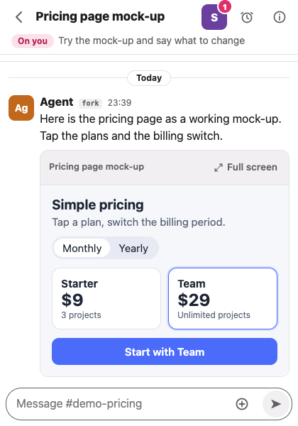
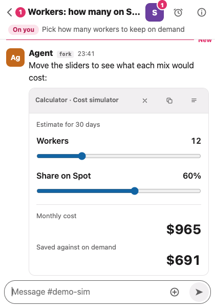
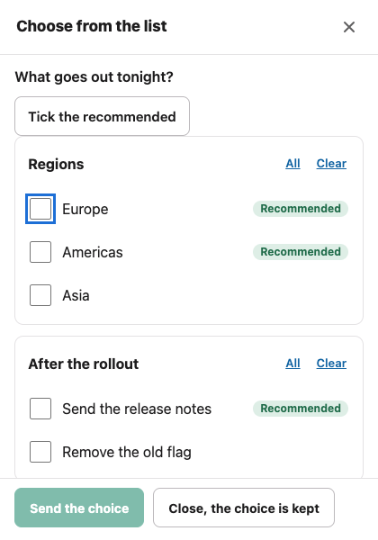
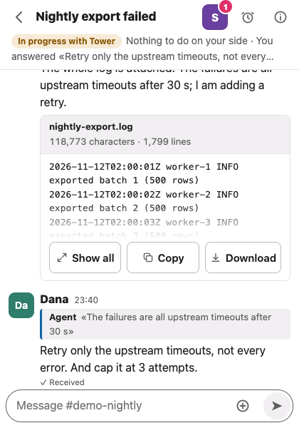
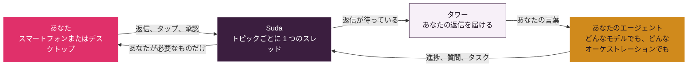

<p align="center">
  
</p>

<p align="center">
  <b><big>トピックはエージェントではない。</big></b><br>
  <i>トピックごとに 1 つのスレッド。作業するのが誰であっても。</i>
</p>

<p align="center">
  <b>どのスレッドも、いま誰の番かを示します：あなたの番、作業中、完了。</b><br>
  <b>どんなモデルでも、どんなオーケストレーションでも。</b>Suda はあなたのマシンで動き、依存関係はありません。
</p>

<p align="center">
  <a href="LICENSE"></a>
  <a href="https://github.com/udiNur/Suda/actions/workflows/ci.yml"></a>
  <a href="https://getsuda.dev/">ウェブサイト</a> ·
  <a href="#quick-start"></a>
  <a href="CONTRIBUTING.md"></a>
  <a href="SECURITY.md"></a>
  <a href="#how-it-works"></a>
  <a href="#phone-and-desktop"></a>
</p>

<p align="center">
  <a href="README.md">English</a> | <a href="README.he.md">עברית</a> | <a href="README.zh-CN.md">简体中文</a> | <a href="README.ja.md">日本語</a> | <a href="README.ko.md">한국어</a> | <a href="README.pt-BR.md">Português (Brasil)</a> | <a href="README.es.md">Español</a>
</p>

<p align="center">これは翻訳です。原文は<a href="README.md">英語版の README</a> です。</p>

<p align="center">
  <a href="#quick-start">クイックスタート</a> ·
  <a href="#features">機能</a> ·
  <a href="#for-agents">エージェント向け</a> ·
  <a href="#security">セキュリティ</a>
</p>

## <a name="quick-start"></a>クイックスタート

**ウィンドウを探し回るのはもうやめよう。トピックに返事をしよう。**

```sh
git clone https://github.com/udiNur/Suda.git suda
cd suda
python3 suda/threads.py install   # creates the board in ~/Documents/mds/boards/threads
python3 suda/server.py            # serves it on http://127.0.0.1:8767/threads/suda.html
```

必要なのは Python 3.9 以降（標準ライブラリのみ）とモダンなブラウザです。macOS と Linux に対応しています。

| 次にやること | 方法 |
|---|---|
| **まず見てみる** | `python3 docs/demo/demo.py` を実行すると、使い捨てのデモボードのアドレスが表示されます。 |
| **エージェントをつなぐ** | [SKILL.md](suda/SKILL.md) をスキルとしてエージェントに渡します。エージェントは `threads` CLI で書き込みます。[エージェント向け](#for-agents)を参照してください。 |
| **返信を知らせる** | `THREADS_NOTIFY_CMD` を設定すると、返信が待っていることがタワー（tower）に伝わります。[セットアップ](#setup)を参照してください。 |
| **スマートフォンで開く** | サーバーは 127.0.0.1 のままにして、その前にゲートウェイを置きます。[セットアップ](#setup)を参照してください。 |

## <a name="features"></a>機能

スクリーンショットはすべて、架空の内容を入れたデモボードのものです。

### どのスレッドも、誰の番かを示す

<table>
<tr><td></td><td><b>リリース 2.4</b></td><td>ステージングへのデプロイを承認する</td></tr>
<tr><td></td><td><b>チケット 1042</b></td><td>2 回目の支払いを返金する？</td></tr>
<tr><td></td><td><b>夜間エクスポート</b></td><td>3 つのバッチを再試行中、まだあなたの出番はありません</td></tr>
<tr><td></td><td><b>コストレポート</b></td><td>完了、要約は中にあります</td></tr>
</table>

トピックごとに 1 つのスレッド。最初の依頼から仕上がった成果まで、ずっと同じスレッドです。ノートは、スレッドを開かない人が読んでもわかるように書きます（「ステージングへのデプロイを承認する」と書き、「更新があります」とは書かない）。

<table>
<tr>
<td width="33%" valign="top"><b>スレッドはトピックであって、エージェントではない。</b><br>1 つのトピックに複数のエージェント、複数のトピックに 1 つのエージェント、そしてエージェントがまったくいないスレッドもあります：サポートチケット、リマインダー、誰かに返事をしなければならない決定。</td>
<td width="33%" valign="top"><b>タスクはトピックと一緒にある。</b><br>依頼はそれぞれ担当者と状態を持つタスクになります。あなたのタスクは別に表示され、未完了のタスクが残っているあいだ、CLI はスレッドを完了にすることを拒みます（強制しない限り）。</td>
<td width="33%" valign="top"><b>質問と答えは離れない。</b><br>あなたの「はい」は、それが答えている質問のボタンに届きます。1 つのスレッドに未回答の質問を 5 つまで置け、それぞれが自分のボタンを持ちます。</td>
</tr>
<tr>
<td valign="top"><b>あなたの番でなければ静か。</b><br>進捗は誰にも通知しません。<i>On you</i>（あなたの番）になるとブラウザ通知が届きます（通知を有効にした場所で）。ただしスレッドがミュートされているか、おやすみ時間中なら届きません。スレッドを好きな時刻までスヌーズすることもできます。</td>
<td valign="top"><b>終わりがある。</b><br>完了したスレッドは静かになり、未完了のものが何もなくなると自動でアーカイブされます。</td>
<td valign="top"><b>エージェントは記録から続ける。</b><br>返信は、トピックの要約とそれまでのメッセージと一緒にエージェントに届き、タスクはコマンド 1 つで取り出せます。</td>
</tr>
</table>

### エージェントはテキスト以外でも答える

<table>
<tr>
<td width="33%" valign="top"><br><b>ダイアグラム。</b>Mermaid のフロー、シーケンス、計画図。全画面表示もソースもワンタップ。</td>
<td width="33%" valign="top"><br><b>Diff。</b>変更された単語と行番号を示し、変更のない行は折りたたみ、横並びでも表示できます。</td>
<td width="33%" valign="top"><br><b>チャート。</b>数値をチャートか表で表示し、CSV と PNG で書き出せます。</td>
</tr>
<tr>
<td valign="top"><br><b>インタラクティブなページ。</b>実際に動くモックアップを、スレッド内でも全画面でも、ネットワークのないサンドボックス化されたフレームで表示します。</td>
<td valign="top"><br><b>もしもカード。</b>スライダーを動かすと、結果が変わるのが見えます。</td>
<td valign="top"><br><b>ライブステータス。</b>その場で更新される 1 枚のカード。ステップごとに新しいメッセージが増えることはありません。</td>
</tr>
</table>

ほかにも：スクロールと書き出しができる表、正確にコピーできるボタン付きのコード、画像、カルーセル、動画、折りたたんだカードに入る長いログ（最大 20 MB）、SVG の図、メッセージ内の次の一手ボタン、そして pull request、コミット、ほかのスレッドを指す短いチップ。`threads help visual` ですべて一覧できます。

### あなたもテキスト以外で答える

<table>
<tr><td><br><b>ワンタップ。</b>番号付きのボタンに、エージェントのおすすめが付きます。返信は 4 秒待ってから送られ、Esc（またはボタン）で取り消せます。</td></tr>
<tr><td><br><b>▶ でコマンドを承認。</b>実行されるコマンドそのものを読んでから確認します。タワーが自分のルールを当てはめ、あなたのマシンで実行し、スレッドで報告します。ブラウザではどんなコマンドも実行されません。</td></tr>
</table>

<table>
<tr>
<td width="33%" valign="top"><br><b>複数の決定を 1 つのフォームで。</b>グループ分けされたチェックボックスにおすすめを添え、自由記入のメモ欄と、見て選ぶ必要のある選択肢のための画像タイルも使えます。</td>
<td width="33%" valign="top"><br><b>言葉そのものを指す。</b>一節を選んで返信すると、エージェントには選んだ言葉と、それが含まれていたメッセージが届きます。</td>
<td width="33%" valign="top"><b>話す。</b>エージェントには文字起こしと録音が届きます（Soniox のキーと安全なページが必要です）。<br><br><b>見せる。</b>キャプション付きの画像。ログやテキストファイルは折りたたまれた添付になります。<br><br><b>分ける。</b>脇道の話題に専用のスレッドを作り、引用と元へのリンクを付けます。<br><br><b>届いたとわかる。</b>あなたの各メッセージの下に：受信済み、引き受け済み、完了。</td>
</tr>
</table>

### たくさんのスレッドを行き来する

<table>
<tr><td><br><b>⌘K：すべてのスレッドとすべてのコマンド。</b>検索し、スレッドへ移動し、設定を変えられます。各スレッドには最後に変わってからの時間が表示されます。</td></tr>
</table>

<table>
<tr>
<td width="33%" valign="top"><b>スラッシュコマンド。</b><br>返信欄で <code>/</code> と入力します：<code>/status</code>、<code>/explain</code>、<code>/review</code> はエージェントに届き、<code>/done</code>、<code>/s</code>（スヌーズ）、<code>/urgent</code>、<code>/mute</code>、<code>/rename</code>、<code>/task</code> はスレッドに作用します。</td>
<td width="33%" valign="top"><b>たくさんのスレッドをまとめて。</b><br>複数を選び（Cmd か Ctrl を押しながらクリック、範囲は Shift クリック、スマートフォンでは長押し）、既読にする、スヌーズ、統合、クローズができます。</td>
<td width="33%" valign="top"><b>スペースなど。</b><br>スペース（たとえば専用のスレッドを持つサポート用スペース）、緊急スレッドを先頭に、統合、リアクション、ライトとダークのテーマ、キーボードショートカット（<code>?</code> で表示）。</td>
</tr>
</table>

## <a name="why-suda"></a>なぜ Suda なのか

**エージェントを動かすのは簡単。ついていくのが難しい。**

**「はい」は、どれに？**

```text
エージェント  ステージングは正常です。2.4 をデプロイしますか？
エージェント  チケット 1042：お客様が 2 回支払っています。返金しますか？
エージェント  夜間エクスポートがまた失敗しました。3 つのバッチがタイムアウト。
あなた        はい
エージェント  デプロイに「はい」ですか、それとも返金に？
```

私は 10 から 15 のコーディングエージェントを同時に動かしています。1 つのチャットでは返信が混ざり、エージェントごとにウィンドウを開けば、自分を待っているものを探し回ることになります。たいていのツールが答えるのは、エージェントをどう動かすかです。Suda が答えるのは、エージェントがあなたに何を求めているかです。

- **エージェントではなく、トピック。** トピックごとに 1 つのスレッド。最初の依頼から仕上がった成果まで、何体のエージェントが関わっても同じです。
- **誰の番か、ひと目で。** どのスレッドも On you（あなたの番）、Working（作業中）、Done（完了）のどれかを、1 行のノートと一緒に示します。
- **目で見える答え。** ダイアグラム、diff、チャート、ライブステータス、インタラクティブなページがスレッドの中に届きます。
- **ワンタップで決める。** エージェントのおすすめが付いたボタン、4 秒以内なら取り消し可能、スマートフォンからでも机からでも。
- **どんなモデルでも、どんなオーケストレーションでも。** Suda はエージェントを起動せず、ターミナルも所有しません：エージェントに必要なのはシェルコマンドを実行できることだけです。
- **あなたのもの、あなたのマシンで。** Python の標準ライブラリだけ、依存関係なし、ビルド不要、HTML ページは 1 枚、サーバーは 127.0.0.1 のみ。MIT ライセンス。

## <a name="how-it-works"></a>仕組み

あなたはトピックに返信します。1 つの AI、**タワー**（tower）が、各返信をそのトピックを担当するエージェントに届け、エージェントは結果や質問をスレッドに直接投稿します。タワーは仲介役であって上司ではありません：どのエージェントがどのトピックを担当しているか、あなたが知る必要はありません。



### どんなモデルでも、どんなオーケストレーションでも

<table>
<tr>
<td width="33%" valign="top"><b>どんなエージェントでも。</b><br>シェルコマンドを実行できるエージェントなら参加できます：<code>threads</code> CLI でスレッドに書き込みます。</td>
<td width="33%" valign="top"><b>どんなモデルでも。</b><br>エージェントの裏にどんなモデルがあっても、同じやり方で参加します。</td>
<td width="33%" valign="top"><b>どんなオーケストレーションでも。</b><br>Suda はエージェントを起動せず、ターミナルも所有しません。必要なのは、タワーに「返信が待っている」と伝えるコマンド 1 つだけです（<code>THREADS_NOTIFY_CMD</code>）。なくても何も失われません：タワーはいつでも好きなときに <code>threads pending</code> を読めます。</td>
</tr>
</table>

これまでに試したのは 1 つの環境だけです：私たちのエージェントは [tuios](https://github.com/Gaurav-Gosain/tuios) の中で動いています。tuios と Claude Code の組み合わせでは、オプションのフック（`live_hook.py`）で、いまどのエージェントがスレッドで作業しているかも表示できます。

## <a name="phone-and-desktop"></a>スマートフォンとデスクトップ

<table>
<tr>
<td width="34%" valign="top" align="center"><br><b>スマートフォンが第一。</b>一度に 1 つのペイン。ホーム画面にアプリとして追加できるウェブページです。</td>
<td width="66%" valign="top" align="center"><br><b>幅の広い画面。</b>一覧と会話を並べて表示します。たとえば折りたたみスマートフォンの内側の画面で。</td>
</tr>
</table>

<table>
<tr><td><br><b>デスクトップ。</b>横に一覧、その隣に開いたスレッド：ここではタスクバーと未回答の質問のあるリリース、実行ブロック、ダイアグラム、長いログ、そして専用スペースのサポートチケット。</td></tr>
</table>

**言語。** コードとデモは英語で、左から右へ書かれています。翻訳は `suda/locales/` にある対応表です（ヘブライ語は右から左で、`suda/locales/he.json` として同梱）：`config.json` で `"lang": "he"` を設定し、`threads install` を実行します。

## <a name="for-agents"></a>エージェント向け

エージェントがすることは、すべて `threads` CLI を通ります：Python ファイル 1 つ、標準ライブラリのみ。[SKILL.md](suda/SKILL.md) をスキルとしてエージェントに渡してください。それが完全なガイドです。

```sh
threads new release-2-4 "Release 2.4" --state working --note "Running the load test"
threads task add release-2-4 "Load test on staging" --owner fork
threads say release-2-4 --from fork "p95 is 180 ms, was 210 ms." --state working --note "Load test passed, writing the changelog"
threads task set release-2-4 1 done
threads ask release-2-4 "Deploy 2.4 to staging?" --options "Deploy,Wait" --recommended "Deploy" --from fork
```

タワーはあなたの答えを受け取り、先へ渡します：

```sh
threads pending                   # the owner's replies that nobody picked up yet
threads ack release-2-4 m3        # picked up (only after the work was handed to an agent)
threads show release-2-4 --json   # also: threads tasks <id>, threads list, threads url [<id>], threads help visual
```

**最後のコマンドが番を決める。** エージェントが書くメッセージにはすべて `--state` と 1 行の `--note` を付けます。そうすればスレッドが誰の番かを示せます。

| エージェントが | スレッドは |
|---|---|
| 質問する | `on-owner` |
| 返信を引き受ける | `working` |
| 作業を終える | `done` |
| 状態なしで書く | オーナーの番になり、読むべきものとして扱われる（安全網） |

コードの中の 3 つの役割は、**owner**（オーナー、ボードの持ち主であるただ 1 人）、**tower**（タワー）、**agents**（エージェント）です。ページは 1 つの HTML ファイル（ビルド不要、CDN なし）で、送るリクエストはちょうど 1 種類だけです。すべての変更は `threads.py` を通り、ファイルロックのもとで、独自のチェックを受けます。`server.py` はボードをループバックで配信します。

## <a name="our-setup"></a>私たちのセットアップ

出発点がほしい人のために、私たちが毎日使っているものを紹介します。Suda はどれがなくても動きますし、私たちはどれとも提携していません。

- **[tuios](https://github.com/Gaurav-Gosain/tuios)**：私たちのエージェントが動く場所。各エージェントが何をしているかを把握するターミナルウィンドウマネージャーです。これがあれば、`live_hook.py` でいまどのエージェントがスレッドで作業しているかを表示できます。
- **[Claude Code](https://github.com/anthropics/claude-code)**：コーディングエージェントそのもの。
- **[Tailscale](https://tailscale.com)**：自分のプライベートネットワーク経由で、どこからでもスマートフォンで Suda を開けます。サーバーはゲートウェイの後ろで 127.0.0.1 のままです（セットアップを参照）。

## <a name="setup"></a>セットアップ

<details>
<summary><b>スマートフォンから開く</b></summary>

サーバーは 127.0.0.1 のままにして、その前にゲートウェイを置きます（たとえば tailnet のようなプライベートネットワーク上の Caddy）。ゲートウェイのホスト名を `SUDA_ALLOWED_HOSTS` に、https のアドレスを `config.json` に書けば、ページがそのアドレスを案内できます（通知とマイクには安全なページが必要です）。[SECURITY.md](SECURITY.md) を参照してください。

</details>

<details>
<summary><b>設定：config.json</b></summary>

このインストールの設定は `~/.config/threads/threads/config.json` に置かれ、リポジトリには決して入りません：

```json
{
  "secure_home": "https://suda.example.com",
  "lang": "en",
  "owner_name": "Dana",
  "commands": {"THREADS_NOTIFY_CMD": "your-command-that-mails-the-tower"}
}
```

</details>

<details>
<summary><b>返信が待っていることをタワーに伝える：THREADS_NOTIFY_CMD</b></summary>

`THREADS_NOTIFY_CMD` は、Suda がタワーに連絡する手段です。引数を 1 つ追加して実行されます。返信が待っていることを知らせる短い通知です（返信そのものは決して渡しません）。返信は、エージェントが受領を確認するまで `threads pending` に残ります。

</details>

<details>
<summary><b>タイマー：threads sweep</b></summary>

スヌーズしたスレッドが起き、完了したスレッドがアーカイブされるのは、`threads sweep --quiet` が実行されたときです。cron、launchd、そのほか任意のスケジューラーで毎分実行してください。

</details>

<details>
<summary><b>サーバーを動かし続ける（任意）</b></summary>

サーバーはページのためだけのものです。動いていてもいなくても、エージェントは `threads` CLI で書き込みます。ボードのデータ（`suda.db`、SQLite）はボードのフォルダーに残り、配信されることはありません。macOS のログイン時にサーバーを起動するには、これを `~/Library/LaunchAgents/dev.suda.server.plist` として保存し（リポジトリのパスは自分のものに）、`launchctl bootstrap gui/$(id -u) ~/Library/LaunchAgents/dev.suda.server.plist` を実行します：

```xml
<?xml version="1.0" encoding="UTF-8"?>
<!DOCTYPE plist PUBLIC "-//Apple//DTD PLIST 1.0//EN" "http://www.apple.com/DTDs/PropertyList-1.0.dtd">
<plist version="1.0">
<dict>
  <key>Label</key><string>dev.suda.server</string>
  <key>ProgramArguments</key>
  <array>
    <string>/usr/bin/python3</string>
    <string>/path/to/suda/suda/server.py</string>
  </array>
  <key>RunAtLoad</key><true/>
  <key>KeepAlive</key><true/>
</dict>
</plist>
```

Linux では、systemd のユーザーサービスで同じことができます（`ExecStart=/usr/bin/python3 /path/to/suda/suda/server.py`）。

</details>

<details>
<summary><b>テストボードと、CLI を PATH に置く方法</b></summary>

デフォルトのフォルダーは本物のボードのために残しておいてください：それ以外の `BOARDS_DIR` はテストボードとして扱われ、そのプライベートフォルダーはすぐ隣に作られます。テストボードはスマートフォンに通知せず、外部コマンドも実行しません。ただし環境変数で代わりのコマンドを指定した場合は別です。

必要なら CLI を PATH に置けます：`ln -s "$PWD/suda/threads.py" ~/.local/bin/threads`。

</details>

## <a name="security"></a>セキュリティ

- サーバーは **127.0.0.1 のみ** で待ち受け、`Host` ヘッダー（DNS rebinding 対策）と、すべての書き込みの `Origin`（CSRF 対策）を確認し、自分のボードフォルダーだけを配信します。
- **ブラウザではどんなコマンドも実行されません。** ▶ 実行ブロックは、それ用に保存された正確なテキスト（ブロックの SHA-256）と照合され、実行するのはタワーだけです。
- エージェントが作ったページは **ネットワークのないサンドボックス化されたフレーム** で動きます。ダイアグラムはサンドボックス化されたフレームで描かれ、画像として表示されます。
- 秘密鍵、プッシュ購読、設定、バックアップは **決して配信されないプライベートフォルダー** に置かれます。

詳細と問題の報告方法は [SECURITY.md](SECURITY.md) にあります。テストが先：テストスイートと変更のルールは [CONTRIBUTING.md](CONTRIBUTING.md) にあります。

## <a name="how-it-compares"></a>ほかのツールとの比較

私たちはこれらの多くを使っているか試したことがあり、毎日使っているものもあります。どれも得意なことでは優れています。以下は私たち自身の使用経験と各ツールのページにもとづいています（2026 年 11 月）。

| | 中心にあるもの | Suda が加えるもの |
|---|---|---|
| **[tuios](https://github.com/Gaurav-Gosain/tuios)** | **ペイン。** エージェントが何をしているかを把握するターミナルウィンドウマネージャー：生き続けるセッション、エージェントの状態、互いにメッセージを送り合うエージェント。私たちのエージェントはここで動いています。 | ペインの上に、トピックを。 |
| **[herdr](https://github.com/herdrdev/herdr)** | **エージェント。** コーディングエージェントのためのランタイム。どのエージェントが作業中か、止まっているかを、複数のマシンをまたいで、スマートフォンからも確認できます。 | どのトピックが自分を必要としていて、そこで何を決めたのか。 |
| **Claude Squad、Conductor、Sculptor** | **エージェントのセッションとそのコード。** 複数のコーディングエージェントを並行して動かし、それぞれが自分の worktree かコンテナーを持ち、変更をレビューできます。 | 複数のエージェントにまたがるトピックや、コードがまったくないトピックの居場所。 |
| **OpenHands** | **エージェントとの会話。** コーディングエージェントと自動化のための、セルフホスト型のコントロールセンター。 | エージェントをまたいで、トピックごとに 1 つのスレッド。 |
| **Devin** | **自前のエージェント。** チームのチャットから呼び出せる、ホスト型の自律エンジニア。 | 自前のエージェントは持ちません。Suda はあなたがすでに動かしているエージェントと一緒に働きます。 |
| **エージェント付きの Linear** | **Issue。** チームの計画された作業のためのトラッカーで、エージェントは issue のコメントで答えます。考え方はいちばん近いものです。 | 1 人の人間のライブな会話。issue には決してならないトピックも含めて。 |
| **Slack、またはボット付きのチームチャット** | **チャンネル。** 私たちが求めていた使い心地で、Suda はそれを借りています。 | 誰の番か、何がまだ未完了か。エージェントごとのボットもトークンも不要で、あなた自身のマシンで。 |

## <a name="license"></a>ライセンス

[MIT](LICENSE)
