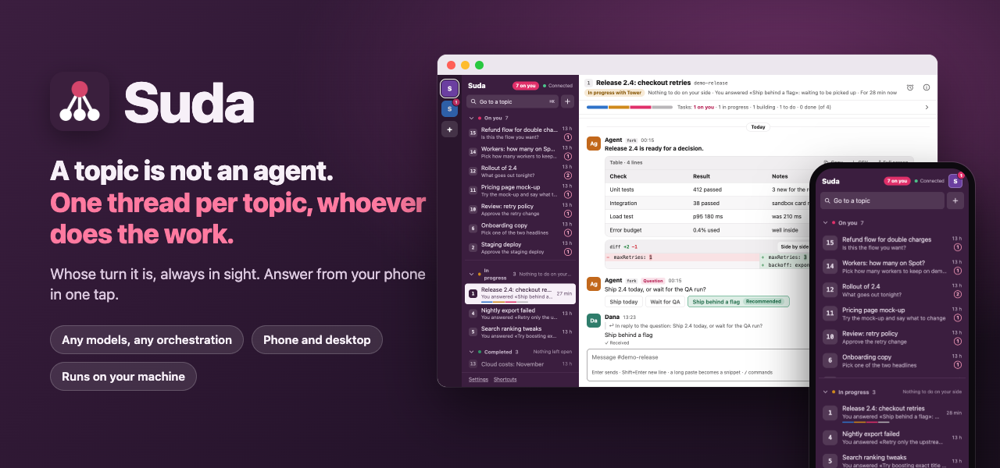
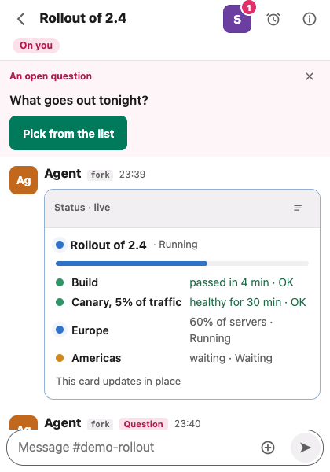
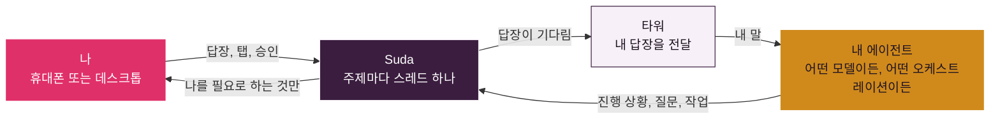

<p align="center">
  
</p>

<p align="center">
  <b><big>주제는 에이전트가 아닙니다.</big></b><br>
  <i>주제마다 스레드 하나. 누가 일을 하든.</i>
</p>

<p align="center">
  <b>모든 스레드는 지금 누구 차례인지 알려 줍니다: 내 차례, 작업 중, 완료.</b><br>
  <b>어떤 모델이든, 어떤 오케스트레이션이든.</b> Suda는 여러분의 컴퓨터에서 돌아가며, 의존성이 없습니다.
</p>

<p align="center">
  <a href="LICENSE"></a>
  <a href="https://github.com/udiNur/Suda/actions/workflows/ci.yml"></a>
  <a href="https://getsuda.dev/">웹사이트</a> ·
  <a href="#quick-start"></a>
  <a href="CONTRIBUTING.md"></a>
  <a href="SECURITY.md"></a>
  <a href="#how-it-works"></a>
  <a href="#phone-and-desktop"></a>
</p>

<p align="center">
  <a href="README.md">English</a> | <a href="README.he.md">עברית</a> | <a href="README.zh-CN.md">简体中文</a> | <a href="README.ja.md">日本語</a> | <a href="README.ko.md">한국어</a> | <a href="README.pt-BR.md">Português (Brasil)</a> | <a href="README.es.md">Español</a>
</p>

<p align="center">이 문서는 번역본입니다. 원문은 <a href="README.md">영어 README</a>입니다.</p>

<p align="center">
  <a href="#quick-start">빠른 시작</a> ·
  <a href="#features">기능</a> ·
  <a href="#for-agents">에이전트용</a> ·
  <a href="#security">보안</a>
</p>

## <a name="quick-start"></a>빠른 시작

**창을 찾아 헤매지 마세요. 주제에 답하세요.**

```sh
git clone https://github.com/udiNur/Suda.git suda
cd suda
python3 suda/threads.py install   # creates the board in ~/Documents/mds/boards/threads
python3 suda/server.py            # serves it on http://127.0.0.1:8767/threads/suda.html
```

Python 3.9 이상(표준 라이브러리만)과 최신 브라우저가 필요합니다. macOS와 Linux를 지원합니다.

| 다음 단계 | 방법 |
|---|---|
| **먼저 둘러보기** | `python3 docs/demo/demo.py`를 실행하면 일회용 데모 보드의 주소가 출력됩니다. |
| **에이전트 연결하기** | [SKILL.md](suda/SKILL.md)를 스킬로 에이전트에게 주세요. 에이전트는 `threads` CLI로 글을 씁니다. [에이전트용](#for-agents)을 참고하세요. |
| **답장 알리기** | `THREADS_NOTIFY_CMD`를 설정하면 답장이 기다리고 있다는 사실을 타워(tower)가 알게 됩니다. [설정](#setup)을 참고하세요. |
| **휴대폰에서 열기** | 서버는 127.0.0.1에 그대로 두고, 그 앞에 게이트웨이를 두세요. [설정](#setup)을 참고하세요. |

## <a name="features"></a>기능

모든 스크린숏은 가상의 내용으로 채운 데모 보드에서 찍었습니다.

### 모든 스레드는 누구 차례인지 알려 줍니다

<table>
<tr><td></td><td><b>릴리스 2.4</b></td><td>스테이징 배포 승인</td></tr>
<tr><td></td><td><b>티켓 1042</b></td><td>두 번째 결제를 환불할까요?</td></tr>
<tr><td></td><td><b>야간 내보내기</b></td><td>배치 3개 재시도 중, 아직 할 일 없음</td></tr>
<tr><td></td><td><b>비용 보고서</b></td><td>완료, 요약은 안에 있음</td></tr>
</table>

주제마다 스레드 하나. 첫 요청부터 완성된 작업까지 같은 스레드입니다. 메모는 스레드를 열어 보지 않을 사람을 위해 씁니다("업데이트가 있습니다"가 아니라 "스테이징 배포 승인"처럼).

<table>
<tr>
<td width="33%" valign="top"><b>스레드는 에이전트가 아니라 주제입니다.</b><br>한 주제에 여러 에이전트, 여러 주제에 한 에이전트, 그리고 에이전트가 전혀 없는 스레드도 있습니다: 지원 티켓, 리마인더, 누군가에게 답해야 할 결정.</td>
<td width="33%" valign="top"><b>작업은 주제와 함께 있습니다.</b><br>요청 하나하나가 담당자와 상태를 가진 작업이 됩니다. 내 작업은 따로 표시되고, 열린 작업이 남아 있으면 CLI는 스레드를 완료로 표시하지 않습니다(강제하지 않는 한).</td>
<td width="33%" valign="top"><b>질문과 답이 떨어지지 않습니다.</b><br>여러분의 "네"는 그것이 답하는 질문의 버튼에 정확히 닿습니다. 스레드마다 열린 질문을 다섯 개까지 둘 수 있고, 질문마다 자기 버튼이 있습니다.</td>
</tr>
<tr>
<td valign="top"><b>내 차례가 아니면 조용합니다.</b><br>진행 상황은 아무에게도 알리지 않습니다. <i>On you</i>(내 차례)가 되면 브라우저 알림을 보냅니다(알림을 켜 둔 곳에서). 단, 스레드가 음소거되어 있거나 방해 금지 시간이면 보내지 않습니다. 원하는 시각까지 스레드를 스누즈할 수도 있습니다.</td>
<td valign="top"><b>끝이 있습니다.</b><br>끝난 스레드는 조용해지고, 열린 것이 하나도 남지 않으면 스스로 보관됩니다.</td>
<td valign="top"><b>에이전트는 기록에서 이어 갑니다.</b><br>답장은 주제의 요약, 이전 메시지와 함께 에이전트에게 전달되고, 작업 목록은 명령 하나로 볼 수 있습니다.</td>
</tr>
</table>

### 에이전트는 텍스트 이상으로 답합니다

<table>
<tr>
<td width="33%" valign="top"><br><b>다이어그램.</b> Mermaid 흐름도, 시퀀스, 계획. 전체 화면도 소스 보기도 탭 한 번이면 됩니다.</td>
<td width="33%" valign="top"><br><b>Diff.</b> 바뀐 단어와 줄 번호를 표시하고, 바뀌지 않은 줄은 접어 둡니다. 나란히 보기도 됩니다.</td>
<td width="33%" valign="top"><br><b>차트.</b> 숫자를 차트나 표로 보여 주고, CSV와 PNG로 내보낼 수 있습니다.</td>
</tr>
<tr>
<td valign="top"><br><b>인터랙티브 페이지.</b> 실제로 동작하는 목업을 스레드 안이나 전체 화면에서, 네트워크가 없는 샌드박스 프레임으로 보여 줍니다.</td>
<td valign="top"><br><b>What-if 카드.</b> 슬라이더를 움직이면 결과가 바뀌는 것이 보입니다.</td>
<td valign="top"><br><b>실시간 상태.</b> 단계마다 새 메시지를 보내는 대신, 제자리에서 갱신되는 카드 하나.</td>
</tr>
</table>

그 밖에도: 스크롤하고 내보낼 수 있는 표, 정확히 복사되는 버튼이 달린 코드, 사진, 캐러셀, 동영상, 접힌 카드에 담긴 긴 로그(최대 20 MB), SVG 그림, 메시지 안의 다음 단계 버튼, 그리고 pull request, 커밋, 다른 스레드를 가리키는 짧은 칩. `threads help visual`로 전체 목록을 볼 수 있습니다.

### 여러분도 텍스트 이상으로 답합니다

<table>
<tr><td><br><b>탭 한 번.</b> 번호가 붙은 버튼에 에이전트의 추천이 표시됩니다. 답장은 4초 동안 기다렸다가 전송되며, Esc(또는 버튼)로 되돌릴 수 있습니다.</td></tr>
<tr><td><br><b>▶로 명령 승인.</b> 실행될 명령을 그대로 읽고 확인합니다. 타워가 자신의 규칙을 적용해 여러분의 컴퓨터에서 실행하고, 결과를 스레드에 보고합니다. 브라우저에서는 어떤 명령도 실행되지 않습니다.</td></tr>
</table>

<table>
<tr>
<td width="33%" valign="top"><br><b>여러 결정을 한 폼에서.</b> 그룹으로 묶인 체크박스와 추천, 자유 메모, 그리고 직접 봐야 고를 수 있는 선택지를 위한 그림 타일.</td>
<td width="33%" valign="top"><br><b>정확한 문장을 가리키기.</b> 구절을 선택하고 답장하면, 에이전트는 선택한 말과 그 말이 들어 있던 메시지를 받습니다.</td>
<td width="33%" valign="top"><b>말하기.</b> 에이전트는 받아쓴 텍스트와 녹음을 함께 받습니다(Soniox 키와 보안 페이지가 필요합니다).<br><br><b>보여 주기.</b> 캡션을 단 사진. 로그나 텍스트 파일은 접힌 첨부 파일이 됩니다.<br><br><b>나누기.</b> 곁가지 이야기는 인용과 원래 스레드로 돌아가는 링크를 달아 별도 스레드로 분리합니다.<br><br><b>전달됐는지 알기.</b> 내가 보낸 메시지마다 아래에: 받음, 넘겨받음, 완료.</td>
</tr>
</table>

### 많은 스레드 사이를 오가기

<table>
<tr><td><br><b>⌘K: 모든 스레드와 모든 명령.</b> 검색하고, 스레드로 이동하고, 설정을 바꿉니다. 각 스레드에는 마지막으로 바뀐 지 얼마나 됐는지 표시됩니다.</td></tr>
</table>

<table>
<tr>
<td width="33%" valign="top"><b>슬래시 명령.</b><br>답장 입력란에 <code>/</code>를 입력하세요: <code>/status</code>, <code>/explain</code>, <code>/review</code>는 에이전트에게 가고, <code>/done</code>, <code>/s</code>(스누즈), <code>/urgent</code>, <code>/mute</code>, <code>/rename</code>, <code>/task</code>는 스레드에 작용합니다.</td>
<td width="33%" valign="top"><b>여러 스레드를 한꺼번에.</b><br>여러 개를 고른 뒤(Cmd 또는 Ctrl 클릭, 범위는 Shift 클릭, 휴대폰에서는 길게 누르기) 읽음 표시, 스누즈, 병합, 닫기를 할 수 있습니다.</td>
<td width="33%" valign="top"><b>스페이스 외.</b><br>스페이스(예: 자체 스레드를 가진 지원용 스페이스), 긴급 스레드 우선 표시, 병합, 리액션, 라이트와 다크 테마, 키보드 단축키(<code>?</code>로 표시).</td>
</tr>
</table>

## <a name="why-suda"></a>왜 Suda인가

**에이전트를 돌리기는 쉽습니다. 따라가기가 어렵습니다.**

**"네"는 무엇에 대한 대답일까요?**

```text
에이전트  스테이징이 정상입니다. 2.4를 배포할까요?
에이전트  티켓 1042: 고객이 두 번 결제했습니다. 환불할까요?
에이전트  야간 내보내기가 또 실패했습니다. 배치 3개가 타임아웃되었습니다.
나        네
에이전트  배포에 대한 "네"인가요, 환불에 대한 "네"인가요?
```

저는 코딩 에이전트를 10~15개씩 동시에 돌립니다. 채팅 하나에서는 답장이 뒤섞이고, 에이전트마다 창을 두면 나를 기다리는 창을 찾아 헤매게 됩니다. 대부분의 도구는 에이전트를 어떻게 돌릴지에 답합니다. Suda는 에이전트가 여러분에게 무엇을 필요로 하는지에 답합니다.

- **에이전트가 아니라 주제.** 주제마다 스레드 하나. 첫 요청부터 완성된 작업까지, 에이전트가 몇이 손대든 마찬가지입니다.
- **누구 차례인지 한눈에.** 모든 스레드는 내 차례, 작업 중, 완료 중 하나를 한 줄 메모와 함께 보여 줍니다.
- **눈으로 보는 답.** 다이어그램, diff, 차트, 실시간 상태, 인터랙티브 페이지가 스레드 안으로 들어옵니다.
- **탭 한 번으로 결정.** 에이전트의 추천이 달린 버튼, 4초 안에 되돌리기, 휴대폰에서도 책상에서도.
- **어떤 모델이든, 어떤 오케스트레이션이든.** Suda는 에이전트를 실행하지 않고 터미널도 소유하지 않습니다: 에이전트는 셸 명령 하나만 실행할 수 있으면 됩니다.
- **여러분의 것, 여러분의 컴퓨터에서.** Python 표준 라이브러리, 의존성 없음, 빌드 단계 없음, HTML 페이지 하나, 127.0.0.1에서만 도는 서버. MIT.

## <a name="how-it-works"></a>동작 방식

여러분은 주제에 답장합니다. **타워**(tower)라는 AI 하나가 각 답장을 그 주제를 맡은 에이전트에게 전달하고, 에이전트는 결과와 질문을 스레드에 바로 올립니다. 타워는 상사가 아니라 중개자입니다: 어느 에이전트가 어느 주제를 맡았는지 여러분이 알 필요는 없습니다.



### 어떤 모델이든, 어떤 오케스트레이션이든

<table>
<tr>
<td width="33%" valign="top"><b>어떤 에이전트든.</b><br>셸 명령을 실행할 수 있는 에이전트라면 무엇이든 참여합니다: <code>threads</code> CLI로 스레드에 글을 씁니다.</td>
<td width="33%" valign="top"><b>어떤 모델이든.</b><br>에이전트 뒤에 어떤 모델이 있든, 똑같은 방식으로 참여합니다.</td>
<td width="33%" valign="top"><b>어떤 오케스트레이션이든.</b><br>Suda는 에이전트를 실행하지 않고 터미널도 소유하지 않습니다. 필요한 것은 타워에 "답장이 기다린다"고 알려 줄 명령 하나뿐입니다(<code>THREADS_NOTIFY_CMD</code>). 없어도 잃는 것은 없습니다: 타워는 언제든 원할 때 <code>threads pending</code>을 읽을 수 있습니다.</td>
</tr>
</table>

지금까지는 한 가지 환경에서만 테스트했습니다: 저희 에이전트는 [tuios](https://github.com/Gaurav-Gosain/tuios)에서 돌아갑니다. tuios와 Claude Code를 함께 쓰면, 선택 사항인 훅(`live_hook.py`)으로 지금 어떤 에이전트가 스레드에서 작업 중인지도 볼 수 있습니다.

## <a name="phone-and-desktop"></a>휴대폰과 데스크톱

<table>
<tr>
<td width="34%" valign="top" align="center"><br><b>휴대폰 우선.</b> 한 번에 화면 하나. 홈 화면에 앱으로 추가하는 웹 페이지입니다.</td>
<td width="66%" valign="top" align="center"><br><b>넓은 화면.</b> 목록과 대화를 나란히 보여 줍니다. 예를 들어 폴더블 폰의 안쪽 화면에서.</td>
</tr>
</table>

<table>
<tr><td><br><b>데스크톱.</b> 옆에는 목록, 그 곁에는 열린 스레드: 여기서는 작업 바와 열린 질문이 있는 릴리스, 실행 블록, 다이어그램, 긴 로그, 그리고 자체 스페이스에 있는 지원 티켓.</td></tr>
</table>

**언어.** 코드와 데모는 영어이며, 왼쪽에서 오른쪽으로 씁니다. 번역은 `suda/locales/`에 있는 표입니다(히브리어는 오른쪽에서 왼쪽으로 쓰며, `suda/locales/he.json`으로 함께 제공됩니다): `config.json`에 `"lang": "he"`를 설정하고 `threads install`을 실행하세요.

## <a name="for-agents"></a>에이전트용

에이전트가 하는 모든 일은 `threads` CLI를 거칩니다: Python 파일 하나, 표준 라이브러리만 씁니다. [SKILL.md](suda/SKILL.md)를 스킬로 에이전트에게 주세요. 그것이 전체 가이드입니다.

```sh
threads new release-2-4 "Release 2.4" --state working --note "Running the load test"
threads task add release-2-4 "Load test on staging" --owner fork
threads say release-2-4 --from fork "p95 is 180 ms, was 210 ms." --state working --note "Load test passed, writing the changelog"
threads task set release-2-4 1 done
threads ask release-2-4 "Deploy 2.4 to staging?" --options "Deploy,Wait" --recommended "Deploy" --from fork
```

타워는 여러분의 답을 받아 다음으로 넘깁니다:

```sh
threads pending                   # the owner's replies that nobody picked up yet
threads ack release-2-4 m3        # picked up (only after the work was handed to an agent)
threads show release-2-4 --json   # also: threads tasks <id>, threads list, threads url [<id>], threads help visual
```

**마지막 명령이 차례를 정합니다.** 에이전트가 쓰는 모든 메시지에는 `--state`와 한 줄짜리 `--note`를 붙여야 합니다. 그래야 스레드가 누구 차례인지 알려 줄 수 있습니다.

| 에이전트가 | 스레드는 |
|---|---|
| 질문하면 | `on-owner` |
| 답장을 넘겨받으면 | `working` |
| 작업을 끝내면 | `done` |
| 상태 없이 쓰면 | 오너 차례가 되어, 읽을거리로 남습니다(안전망) |

코드에서 세 가지 역할은 **owner**(오너, 이 보드의 주인인 단 한 사람), **tower**(타워), **agents**(에이전트)입니다. 페이지는 HTML 파일 하나(빌드 단계 없음, CDN 없음)이고, 보내는 요청은 딱 한 종류뿐입니다. 모든 변경은 `threads.py`를 거치며, 파일 잠금 아래에서 자체 검사를 받습니다. `server.py`는 보드를 루프백에서 제공합니다.

## <a name="our-setup"></a>저희의 구성

시작점이 필요하다면, 저희가 매일 쓰는 것들을 참고하세요. Suda는 이것들 없이도 동작하며, 저희는 이들과 아무런 제휴 관계가 없습니다.

- **[tuios](https://github.com/Gaurav-Gosain/tuios)**: 저희 에이전트가 돌아가는 곳으로, 각 에이전트가 무엇을 하고 있는지 아는 터미널 창 관리자입니다. 이것과 함께라면 `live_hook.py`로 지금 어떤 에이전트가 스레드에서 작업 중인지 볼 수 있습니다.
- **[Claude Code](https://github.com/anthropics/claude-code)**: 코딩 에이전트 그 자체.
- **[Tailscale](https://tailscale.com)**: 나만의 사설 네트워크를 통해 어디서든 휴대폰으로 Suda를 엽니다. 서버는 게이트웨이 뒤에서 127.0.0.1에 그대로 머뭅니다(설정 참고).

## <a name="setup"></a>설정

<details>
<summary><b>휴대폰에서 열기</b></summary>

서버는 127.0.0.1에 그대로 두고, 그 앞에 게이트웨이를 두세요(예: tailnet 같은 사설 네트워크 위의 Caddy). 게이트웨이의 호스트 이름은 `SUDA_ALLOWED_HOSTS`에, https 주소는 `config.json`에 적으면 페이지가 그 주소를 안내할 수 있습니다(알림과 마이크에는 보안 페이지가 필요합니다). [SECURITY.md](SECURITY.md)를 참고하세요.

</details>

<details>
<summary><b>설정: config.json</b></summary>

이 설치본의 설정은 리포지토리가 아니라 `~/.config/threads/threads/config.json`에 있습니다:

```json
{
  "secure_home": "https://suda.example.com",
  "lang": "en",
  "owner_name": "Dana",
  "commands": {"THREADS_NOTIFY_CMD": "your-command-that-mails-the-tower"}
}
```

</details>

<details>
<summary><b>답장이 기다린다고 타워에 알리기: THREADS_NOTIFY_CMD</b></summary>

`THREADS_NOTIFY_CMD`는 Suda가 타워에 연락하는 방법입니다. 인수 하나를 더 붙여 실행되는데, 그 인수는 답장이 기다린다는 짧은 알림입니다(답장 자체는 절대 넘기지 않습니다). 답장은 에이전트가 수신을 확인할 때까지 `threads pending`에 남아 있습니다.

</details>

<details>
<summary><b>타이머: threads sweep</b></summary>

스누즈한 스레드가 깨어나고 끝난 스레드가 보관되는 것은 `threads sweep --quiet`가 실행될 때입니다. cron, launchd 등 어떤 스케줄러로든 1분마다 실행하세요.

</details>

<details>
<summary><b>서버를 계속 실행해 두기 (선택)</b></summary>

서버는 페이지만을 위한 것입니다. 서버가 실행 중이든 아니든 에이전트는 `threads` CLI로 씁니다. 보드의 데이터(`suda.db`, SQLite)는 보드 폴더에 남고, 절대 제공되지 않습니다. macOS에서 로그인할 때 서버를 시작하려면 이것을 `~/Library/LaunchAgents/dev.suda.server.plist`로 저장하고(저장소 경로는 직접 바꾸세요) `launchctl bootstrap gui/$(id -u) ~/Library/LaunchAgents/dev.suda.server.plist`을 실행하세요:

```xml
<?xml version="1.0" encoding="UTF-8"?>
<!DOCTYPE plist PUBLIC "-//Apple//DTD PLIST 1.0//EN" "http://www.apple.com/DTDs/PropertyList-1.0.dtd">
<plist version="1.0">
<dict>
  <key>Label</key><string>dev.suda.server</string>
  <key>ProgramArguments</key>
  <array>
    <string>/usr/bin/python3</string>
    <string>/path/to/suda/suda/server.py</string>
  </array>
  <key>RunAtLoad</key><true/>
  <key>KeepAlive</key><true/>
</dict>
</plist>
```

Linux에서는 systemd 사용자 서비스가 같은 일을 합니다(`ExecStart=/usr/bin/python3 /path/to/suda/suda/server.py`).

</details>

<details>
<summary><b>테스트 보드, 그리고 PATH에 CLI 두기</b></summary>

기본 폴더는 실제 보드용으로 남겨 두세요: 그 밖의 `BOARDS_DIR`은 모두 테스트 보드로 취급되며, 그 비공개 폴더는 바로 옆에 생깁니다. 테스트 보드는 휴대폰에 알림을 보내지 않고 외부 명령도 실행하지 않습니다. 단, 환경 변수로 대신 쓸 명령을 지정한 경우는 예외입니다.

원한다면 CLI를 PATH에 둘 수 있습니다: `ln -s "$PWD/suda/threads.py" ~/.local/bin/threads`.

</details>

## <a name="security"></a>보안

- 서버는 **127.0.0.1에서만** 수신하고, `Host` 헤더(DNS rebinding 방지)와 모든 쓰기 요청의 `Origin`(CSRF 방지)을 확인하며, 자신의 보드 폴더만 제공합니다.
- **브라우저에서는 어떤 명령도 실행되지 않습니다.** ▶ 실행 블록은 그 블록용으로 저장된 정확한 텍스트(블록의 SHA-256)와 대조되며, 실행은 타워만 합니다.
- 에이전트가 만든 페이지는 **네트워크가 없는 샌드박스 프레임**에서 실행됩니다. 다이어그램은 샌드박스 프레임에서 그려진 뒤 이미지로 표시됩니다.
- 개인 키, 푸시 구독, 설정, 백업은 **절대 제공되지 않는 비공개 폴더**에 보관됩니다.

자세한 내용과 문제 신고 방법은 [SECURITY.md](SECURITY.md)에 있습니다. 테스트가 먼저입니다: 테스트 스위트와 변경 규칙은 [CONTRIBUTING.md](CONTRIBUTING.md)에 있습니다.

## <a name="how-it-compares"></a>다른 도구와의 비교

저희는 이 중 대부분을 쓰고 있거나 써 봤고, 일부는 매일 씁니다. 모두 자기 분야에서 훌륭한 도구입니다. 아래 내용은 저희가 직접 써 본 경험과 각 도구의 공식 페이지를 바탕으로 했습니다(2026년 11월).

| | 중심에 두는 것 | Suda가 더하는 것 |
|---|---|---|
| **[tuios](https://github.com/Gaurav-Gosain/tuios)** | **창(pane).** 에이전트가 무엇을 하고 있는지 아는 터미널 창 관리자: 계속 살아 있는 세션, 에이전트 상태, 서로 메시지를 주고받는 에이전트. 저희 에이전트가 돌아가는 곳입니다. | 창 위에 주제를 얹습니다. |
| **[herdr](https://github.com/herdrdev/herdr)** | **에이전트.** 코딩 에이전트를 위한 런타임으로, 어떤 에이전트가 작업 중이고 어떤 에이전트가 막혀 있는지를 여러 머신에 걸쳐, 휴대폰에서도 보여 줍니다. | 어떤 주제가 나를 필요로 하고, 거기서 무엇을 결정했는가? |
| **Claude Squad, Conductor, Sculptor** | **에이전트 세션과 그 코드.** 여러 코딩 에이전트를 각자의 worktree나 컨테이너에서 병렬로 돌리고, 그 변경을 리뷰합니다. | 여러 에이전트에 걸쳐 있거나, 코드가 전혀 없는 주제가 머물 곳. |
| **OpenHands** | **에이전트와의 대화.** 코딩 에이전트와 자동화를 위한 셀프 호스팅 컨트롤 센터. | 에이전트를 가로질러, 주제마다 스레드 하나. |
| **Devin** | **자체 에이전트.** 팀 채팅에서 부를 수 있는 호스팅형 자율 엔지니어. | 자체 에이전트가 없습니다. Suda는 여러분이 이미 돌리고 있는 에이전트와 함께 일합니다. |
| **에이전트를 붙인 Linear** | **이슈.** 팀의 계획된 작업을 위한 트래커로, 에이전트가 이슈 댓글로 답합니다. 취지로는 가장 가깝습니다. | 한 사람의 실시간 대화. 결코 이슈가 되지 않을 주제까지 포함해서. |
| **Slack, 또는 봇이 있는 팀 채팅** | **채널.** 저희가 원했던 느낌이고, Suda는 그것을 빌려 왔습니다. | 누구 차례인지, 무엇이 아직 열려 있는지. 에이전트마다 봇이나 토큰이 필요 없고, 여러분의 컴퓨터에서 돌아갑니다. |

## <a name="license"></a>라이선스

[MIT](LICENSE)
