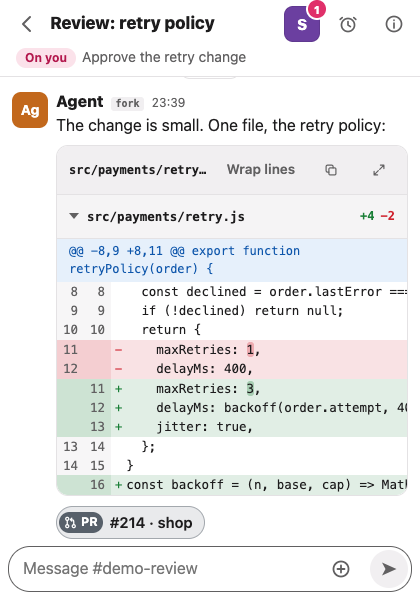
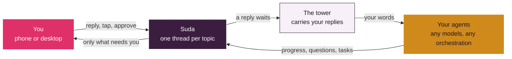
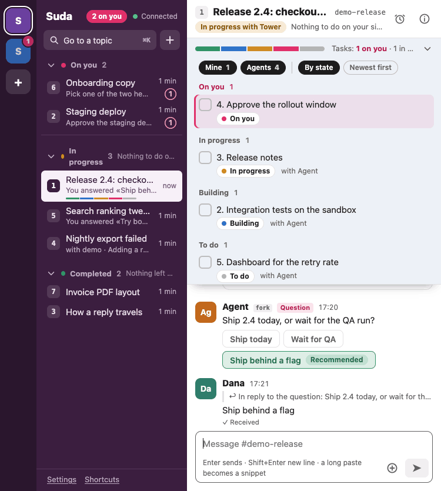
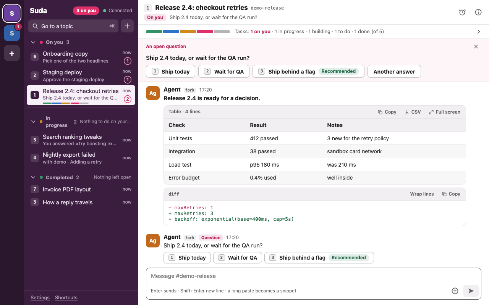

<p align="center">
  
</p>

<p align="center">
  <b><big>A topic is not an agent.</big></b><br>
  <i>One thread per topic, whoever does the work.</i>
</p>

<p align="center">
  <b>Every thread says whose turn it is: on you, working or done.</b><br>
  <b>Any models, any orchestration.</b> Suda runs on your machine, with no dependencies.
</p>

<p align="center">
  <a href="LICENSE"></a>
  <a href="https://github.com/udiNur/Suda/actions/workflows/ci.yml"></a>
  <a href="https://getsuda.dev/">Website</a> ·
  <a href="#quick-start"></a>
  <a href="CONTRIBUTING.md"></a>
  <a href="SECURITY.md"></a>
  <a href="#how-it-works"></a>
  <a href="#phone-and-desktop"></a>
</p>

<p align="center">
  <a href="README.md">English</a> | <a href="README.he.md">עברית</a> | <a href="README.zh-CN.md">简体中文</a> | <a href="README.ja.md">日本語</a> | <a href="README.ko.md">한국어</a> | <a href="README.pt-BR.md">Português (Brasil)</a> | <a href="README.es.md">Español</a>
</p>

<p align="center">
  <a href="#quick-start">Quick start</a> ·
  <a href="#features">Features</a> ·
  <a href="#for-agents">For agents</a> ·
  <a href="#security">Security</a>
</p>

## <a name="quick-start"></a>Quick start

**Stop hunting windows. Answer the topic.**

```sh
git clone https://github.com/udiNur/Suda.git suda
cd suda
python3 suda/threads.py install   # creates the board in ~/Documents/mds/boards/threads
python3 suda/server.py            # serves it on http://127.0.0.1:8767/threads/suda.html
```

Needs Python 3.9 or newer (standard library only) and a modern browser. macOS and Linux.

| Next | How |
|---|---|
| **Look around first** | `python3 docs/demo/demo.py` prints the address of a throwaway demo board. |
| **Connect your agents** | Give them [SKILL.md](suda/SKILL.md) as a skill. They write with the `threads` CLI: see [For agents](#for-agents). |
| **Hear about replies** | Set `THREADS_NOTIFY_CMD` so your tower learns that a reply waits: see [Setup](#setup). |
| **Open it on your phone** | Keep the server on 127.0.0.1 and put a gateway in front of it: see [Setup](#setup). |

## <a name="features"></a>Features

All screenshots come from a demo board with invented content.

### Every thread says whose turn it is

<table>
<tr><td></td><td><b>Release 2.4</b></td><td>Approve the staging deploy</td></tr>
<tr><td></td><td><b>Ticket 1042</b></td><td>Refund the second payment?</td></tr>
<tr><td></td><td><b>Nightly export</b></td><td>Retrying 3 batches, nothing for you yet</td></tr>
<tr><td></td><td><b>Cost report</b></td><td>Finished, summary inside</td></tr>
</table>

One thread per topic, from the first request to the finished work. The note is written for someone who will
not open the thread ("Approve the staging deploy", never "There is an update").

<table>
<tr>
<td width="33%" valign="top"><b>A thread is a topic, not an agent.</b><br>Several agents on one topic, one agent in several, and threads with no agent at all: a support ticket, a reminder, a decision you owe someone.</td>
<td width="33%" valign="top"><b>Tasks stay with the topic.</b><br>Each request is a task with an owner and a status. Yours are shown apart, and the CLI refuses to mark a thread done while tasks are open (unless forced).</td>
<td width="33%" valign="top"><b>Questions stay attached.</b><br>Your "yes" lands on the button of the question it answers. Up to five open questions per thread, each with its own buttons.</td>
</tr>
<tr>
<td valign="top"><b>Quiet unless it is your turn.</b><br>Progress notifies nobody. <i>On you</i> sends a browser notification (where you enabled them), unless the thread is muted or quiet hours are on. Snooze a thread until a time you choose.</td>
<td valign="top"><b>It ends.</b><br>A finished thread goes quiet and archives itself once nothing in it is open.</td>
<td valign="top"><b>Agents continue from the record.</b><br>A reply reaches an agent with the topic's summary and earlier messages, and the tasks are one command away.</td>
</tr>
</table>

### Agents answer with more than text

<table>
<tr>
<td width="33%" valign="top"><br><b>Diagrams.</b> Mermaid flows, sequences and plans, with full screen and the source one tap away.</td>
<td width="33%" valign="top"><br><b>Diffs.</b> Changed words and line numbers, unchanged lines folded, or side by side.</td>
<td width="33%" valign="top"><br><b>Charts.</b> The numbers as a chart or a table, with CSV and PNG export.</td>
</tr>
<tr>
<td valign="top"><br><b>Interactive pages.</b> A working mock-up, in the thread or full screen, in a sandboxed frame with no network.</td>
<td valign="top"><br><b>What-if cards.</b> Move a slider and see the results change.</td>
<td valign="top"><br><b>Live status.</b> One card that updates in place, not a new message for every step.</td>
</tr>
</table>

Also: tables that scroll and export, code with an exact copy button, pictures, carousels, video, long logs in a
collapsed card (up to 20 MB), SVG drawings, next-step buttons inside a message, and short chips for pull
requests, commits and other threads. `threads help visual` lists all of them.

### You answer with more than text

<table>
<tr><td><br><b>One tap.</b> Numbered buttons with the agent's recommendation. The reply waits four seconds, and Esc (or the button) takes it back.</td></tr>
<tr><td><br><b>Approve a command with ▶.</b> Read the exact command and confirm. The tower applies its rules, runs it on your machine and reports in the thread. No command runs in the browser.</td></tr>
</table>

<table>
<tr>
<td width="33%" valign="top"><br><b>Several decisions in one form.</b> Checkboxes in groups, with recommendations, a free note, and picture tiles for options you have to see.</td>
<td width="33%" valign="top"><br><b>Point to the exact words.</b> Mark a passage and reply: the agent gets the marked words and the message they came from.</td>
<td width="33%" valign="top"><b>Speak.</b> The agent gets the transcript and the recording (needs a Soniox key and a secure page).<br><br><b>Show.</b> Pictures with captions. A log or a text file becomes a collapsed attachment.<br><br><b>Split.</b> Give a side issue its own thread, with a quote and a link back.<br><br><b>Know you were heard.</b> Under each message of yours: received, picked up, done.</td>
</tr>
</table>

### Move through many threads

<table>
<tr><td><br><b>⌘K: every thread and every command.</b> Search, jump to a thread or change a setting. Each thread shows how long ago it last changed.</td></tr>
</table>

<table>
<tr>
<td width="33%" valign="top"><b>Slash commands.</b><br>Type <code>/</code> in the reply box: <code>/status</code>, <code>/explain</code> and <code>/review</code> go to the agents; <code>/done</code>, <code>/s</code> (snooze), <code>/urgent</code>, <code>/mute</code>, <code>/rename</code> and <code>/task</code> act on the thread.</td>
<td width="33%" valign="top"><b>Many threads at once.</b><br>Choose several (Cmd or Ctrl click, Shift click for a range, a long press on the phone), then mark read, snooze, merge or close.</td>
<td width="33%" valign="top"><b>Spaces and more.</b><br>Spaces (for example a support space with its own threads), urgent threads first, merge, reactions, light and dark themes, and keyboard shortcuts (<code>?</code> shows them).</td>
</tr>
</table>

## <a name="why-suda"></a>Why Suda

**Running agents is easy. Keeping up is hard.**

**Yes to what?**

```text
agent  Staging is green. Deploy 2.4?
agent  Ticket 1042: the customer paid twice. Refund?
agent  The nightly export failed again, 3 batches timed out.
you    yes
agent  Yes to the deploy, or to the refund?
```

I run 10 to 15 coding agents at once. In one chat their replies mix; with a window per agent you hunt for the
one that waits for you. Most tools answer how to run agents. Suda answers what they need from you.

- **Topics, not agents.** One thread per topic, from the first request to the finished work, however many
  agents touch it.
- **Whose turn, at a glance.** Every thread says On you, Working or Done, with a one-line note.
- **Answers you can see.** Diagrams, diffs, charts, live status and interactive pages arrive inside the thread.
- **Decisions in one tap.** Buttons with the agent's recommendation, four seconds to undo, from your phone or
  your desk.
- **Any models, any orchestration.** Suda starts no agents and owns no
  terminals: an agent only needs to run a shell command.
- **Yours, on your machine.** Python standard library, no dependencies, no build step, one HTML page, a server
  on 127.0.0.1 only. MIT.

## <a name="how-it-works"></a>How it works

You reply in the topic. One AI, the **tower**, carries each reply to the agent working on that topic, and the
agents post results and questions straight into the thread. The tower is a go-between, not a boss: you never
have to know which agent has which topic.



### Any models, any orchestration

<table>
<tr>
<td width="33%" valign="top"><b>Any agent.</b><br>Any agent that can run a shell command takes part: it writes into threads with the <code>threads</code> CLI.</td>
<td width="33%" valign="top"><b>Any models.</b><br>Whatever model is behind an agent, it takes part the same way.</td>
<td width="33%" valign="top"><b>Any orchestration.</b><br>Suda starts no agents and owns no terminals. It needs one command that tells your tower "a reply waits" (<code>THREADS_NOTIFY_CMD</code>). Without it nothing is lost: the tower can read <code>threads pending</code> whenever it likes.</td>
</tr>
</table>

Tested so far on one setup: our agents run in [tuios](https://github.com/Gaurav-Gosain/tuios). With tuios and
Claude Code, an optional hook (`live_hook.py`) also shows which agents are working on a thread right now.

## <a name="phone-and-desktop"></a>Phone and desktop

<table>
<tr>
<td width="34%" valign="top" align="center"><br><b>Phone first.</b> One pane at a time. It is a web page you add to the home screen as an app.</td>
<td width="66%" valign="top" align="center"><br><b>Wider screens.</b> The list beside the conversation, for example on the inner screen of a foldable.</td>
</tr>
</table>

<table>
<tr><td><br><b>Desktop.</b> The list on the side and the open thread beside it: here a release with its tasks bar and open question, a run block, a diagram, a long log, and a support ticket in its own space.</td></tr>
</table>

**Languages.** The code and the demo are in English, left to right. A translation is a table in `suda/locales/`
(Hebrew, right to left, ships in `suda/locales/he.json`): set `"lang": "he"` in `config.json` and run
`threads install`.

## <a name="for-agents"></a>For agents

Everything an agent does goes through the `threads` CLI: one Python file, standard library only. Give your
agents [SKILL.md](suda/SKILL.md) as a skill. It is the full guide.

```sh
threads new release-2-4 "Release 2.4" --state working --note "Running the load test"
threads task add release-2-4 "Load test on staging" --owner fork
threads say release-2-4 --from fork "p95 is 180 ms, was 210 ms." --state working --note "Load test passed, writing the changelog"
threads task set release-2-4 1 done
threads ask release-2-4 "Deploy 2.4 to staging?" --options "Deploy,Wait" --recommended "Deploy" --from fork
```

The tower picks up what you answered and passes it on:

```sh
threads pending                   # the owner's replies that nobody picked up yet
threads ack release-2-4 m3        # picked up (only after the work was handed to an agent)
threads show release-2-4 --json   # also: threads tasks <id>, threads list, threads url [<id>], threads help visual
```

**The last command sets the turn.** Every message an agent writes should carry `--state` and a one-line
`--note`, so the thread says whose turn it is.

| The agent | The thread becomes |
|---|---|
| asks a question | `on-owner` |
| picks up a reply | `working` |
| finishes the work | `done` |
| writes with no state | on the owner, as something to read (a safety net) |

In the code the three roles are the **owner** (the one person the board is for), the **tower** and the
**agents**. The page is a single HTML file (no build step, no CDN) that writes exactly one kind of request.
Every change goes through `threads.py`, under a file lock, with its own checks. `server.py` serves the board on
loopback.

## <a name="our-setup"></a>Our setup

What we run every day, if you want a starting point. Suda works without any of them, and we are not affiliated
with them.

- **[tuios](https://github.com/Gaurav-Gosain/tuios)**: where our agents run, a terminal window manager that knows
  what each agent is doing. With it, `live_hook.py` shows which agents are working on a thread right now.
- **[Claude Code](https://github.com/anthropics/claude-code)**: the coding agents themselves.
- **[Tailscale](https://tailscale.com)**: Suda on your phone from anywhere, over your own private network, while
  the server stays on 127.0.0.1 behind a gateway (see Setup).

## <a name="setup"></a>Setup

<details>
<summary><b>Open it from your phone</b></summary>

Keep the server on 127.0.0.1 and put a gateway in front of it (for example Caddy on a private network such as a
tailnet). Name the gateway's host in `SUDA_ALLOWED_HOSTS`, and its https address in `config.json` so the page
can offer it (notifications and the microphone need a secure page). See [SECURITY.md](SECURITY.md).

</details>

<details>
<summary><b>Settings: config.json</b></summary>

This installation's settings live in `~/.config/threads/threads/config.json`, never in the repo:

```json
{
  "secure_home": "https://suda.example.com",
  "lang": "en",
  "owner_name": "Dana",
  "commands": {"THREADS_NOTIFY_CMD": "your-command-that-mails-the-tower"}
}
```

</details>

<details>
<summary><b>Tell your tower that a reply waits: THREADS_NOTIFY_CMD</b></summary>

`THREADS_NOTIFY_CMD` is how Suda reaches your tower. It is run with one extra argument, a short notice that a
reply waits (never the reply itself). Replies stay in `threads pending` until an agent acknowledges them.

</details>

<details>
<summary><b>A timer: threads sweep</b></summary>

Snoozed threads wake and finished threads archive when `threads sweep --quiet` runs. Run it every minute from
cron, launchd or any scheduler.

</details>

<details>
<summary><b>Keep the server running (optional)</b></summary>

The server is only for the page: agents write with the `threads` CLI whether it runs or not. The board's data
(`suda.db`, SQLite) stays in the board's folder and is never served. To start the server at login on macOS, save
this as `~/Library/LaunchAgents/dev.suda.server.plist` (with your own path to the repo), then run
`launchctl bootstrap gui/$(id -u) ~/Library/LaunchAgents/dev.suda.server.plist`:

```xml
<?xml version="1.0" encoding="UTF-8"?>
<!DOCTYPE plist PUBLIC "-//Apple//DTD PLIST 1.0//EN" "http://www.apple.com/DTDs/PropertyList-1.0.dtd">
<plist version="1.0">
<dict>
  <key>Label</key><string>dev.suda.server</string>
  <key>ProgramArguments</key>
  <array>
    <string>/usr/bin/python3</string>
    <string>/path/to/suda/suda/server.py</string>
  </array>
  <key>RunAtLoad</key><true/>
  <key>KeepAlive</key><true/>
</dict>
</plist>
```

On Linux a systemd user service does the same (`ExecStart=/usr/bin/python3 /path/to/suda/suda/server.py`).

</details>

<details>
<summary><b>Test boards, and the CLI on your PATH</b></summary>

Keep the default folder for your real board: any other `BOARDS_DIR` is treated as a test board, with its
private folder beside it. A test board reaches no phone and runs no outside command, unless you name a stand-in
command in an environment variable.

Optionally put the CLI on your PATH: `ln -s "$PWD/suda/threads.py" ~/.local/bin/threads`.

</details>

## <a name="security"></a>Security

- The server listens on **127.0.0.1 only**, checks the `Host` header (DNS rebinding) and the `Origin` of every
  write (CSRF), and serves only its own board folder.
- **No command runs in the browser.** A ▶ run block is checked against the exact text stored for it (a SHA-256
  of the block), and only the tower runs it.
- Agent-made pages run in a **sandboxed frame with no network**. Diagrams are drawn in a sandboxed frame and
  shown as images.
- Private keys, push subscriptions, settings and backups live in a **private folder that is never served**.

Details, and how to report a problem, in [SECURITY.md](SECURITY.md). Tests come first: the suites and the rules
for a change are in [CONTRIBUTING.md](CONTRIBUTING.md).

## <a name="how-it-compares"></a>How it compares

We use or have tried most of these, some of them every day, and they are good at what they do. From our own
use and their own pages, November 2026.

| | Built around | What Suda adds |
|---|---|---|
| **[tuios](https://github.com/Gaurav-Gosain/tuios)** | **The pane.** A terminal window manager that knows what your agents are doing: sessions that stay alive, agent states, agents that message each other. It is where our agents run. | The topic, on top of the pane. |
| **[herdr](https://github.com/herdrdev/herdr)** | **The agent.** A runtime for coding agents that shows which agent is working or blocked, across machines and from a phone. | Which topic needs me, and what did we decide in it? |
| **Claude Squad, Conductor, Sculptor** | **The agent session and its code.** Several coding agents in parallel, each in its own worktree or container, with review of their changes. | A home for a topic that spans several agents, or has no code at all. |
| **OpenHands** | **Conversations with agents.** A self-hosted control center for coding agents and automations. | One thread per topic, across agents. |
| **Devin** | **Its own agent.** A hosted autonomous engineer you can reach from a team chat. | No agent of its own. Suda works with the ones you already run. |
| **Linear with agents** | **The issue.** A tracker for a team's planned work, where agents answer in the issue's comments. The closest in spirit. | One person's live conversation, including topics that will never be an issue. |
| **Slack, or any team chat with bots** | **The channel.** The feel we wanted, and Suda borrows it. | Whose turn it is and what is still open, with no bot or token per agent, on your own machine. |

## <a name="license"></a>License

[MIT](LICENSE)
