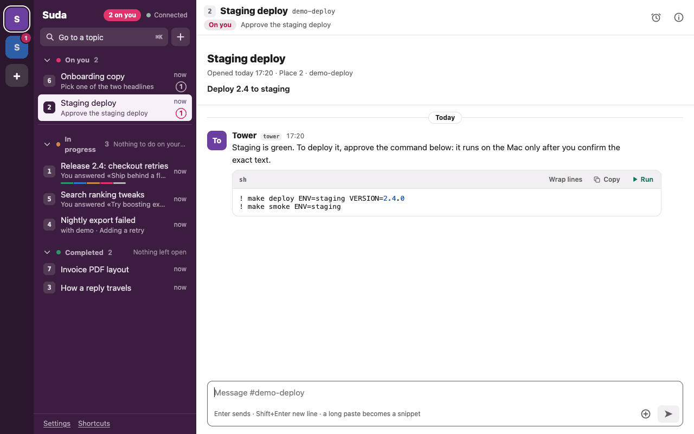
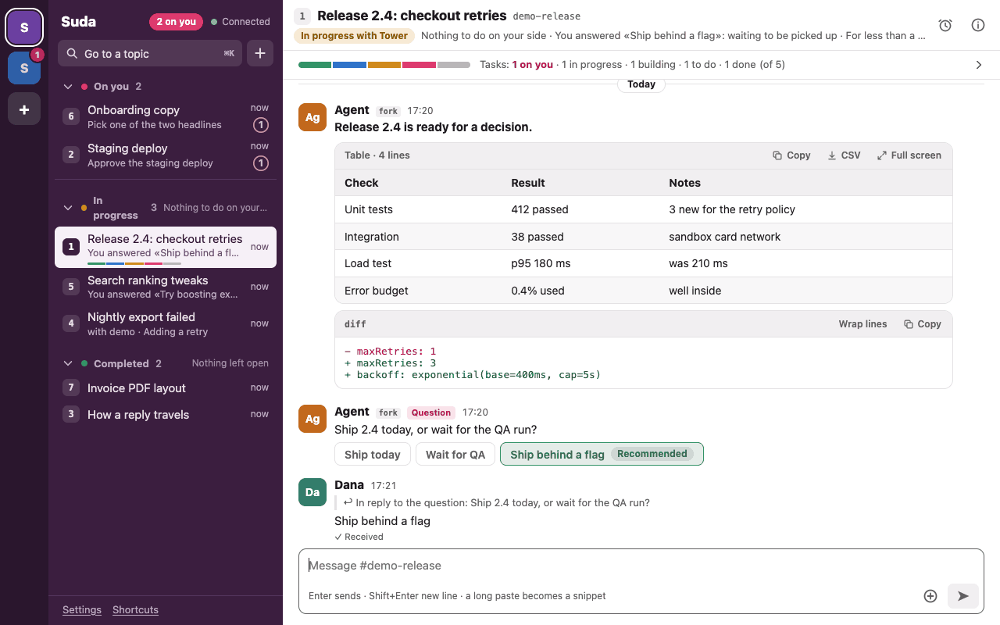
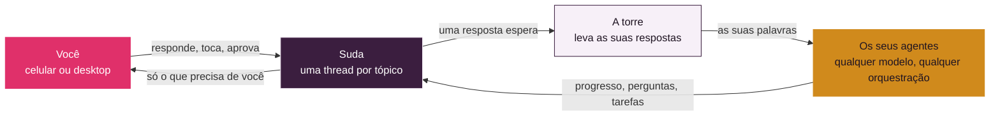

<p align="center">
  
</p>

<p align="center">
  <b><big>Um tópico não é um agente.</big></b><br>
  <i>Uma thread por tópico, não importa quem faça o trabalho.</i>
</p>

<p align="center">
  <b>Cada thread diz de quem é a vez: com você, em andamento ou concluída.</b><br>
  <b>Qualquer modelo, qualquer orquestração.</b> O Suda roda na sua máquina, sem dependências.
</p>

<p align="center">
  <a href="LICENSE"></a>
  <a href="https://github.com/udiNur/Suda/actions/workflows/ci.yml"></a>
  <a href="https://getsuda.dev/">Site</a> ·
  <a href="#quick-start"></a>
  <a href="CONTRIBUTING.md"></a>
  <a href="SECURITY.md"></a>
  <a href="#how-it-works"></a>
  <a href="#phone-and-desktop"></a>
</p>

<p align="center">
  <a href="README.md">English</a> | <a href="README.he.md">עברית</a> | <a href="README.zh-CN.md">简体中文</a> | <a href="README.ja.md">日本語</a> | <a href="README.ko.md">한국어</a> | <a href="README.pt-BR.md">Português (Brasil)</a> | <a href="README.es.md">Español</a>
</p>

<p align="center">Esta é uma tradução. O original é o <a href="README.md">README em inglês</a>.</p>

<p align="center">
  <a href="#quick-start">Início rápido</a> ·
  <a href="#features">Recursos</a> ·
  <a href="#for-agents">Para agentes</a> ·
  <a href="#security">Segurança</a>
</p>

## <a name="quick-start"></a>Início rápido

**Pare de caçar janelas. Responda ao tópico.**

```sh
git clone https://github.com/udiNur/Suda.git suda
cd suda
python3 suda/threads.py install   # creates the board in ~/Documents/mds/boards/threads
python3 suda/server.py            # serves it on http://127.0.0.1:8767/threads/suda.html
```

Precisa de Python 3.9 ou mais recente (só a biblioteca padrão) e de um navegador moderno. macOS e Linux.

| Próximo passo | Como |
|---|---|
| **Dê uma olhada primeiro** | `python3 docs/demo/demo.py` mostra o endereço de um quadro de demonstração descartável. |
| **Conecte seus agentes** | Entregue a eles o [SKILL.md](suda/SKILL.md) como skill. Eles escrevem com a CLI `threads`: veja [Para agentes](#for-agents). |
| **Fique sabendo das respostas** | Defina `THREADS_NOTIFY_CMD` para que a sua torre (tower) saiba que há uma resposta esperando: veja [Configuração](#setup). |
| **Abra no celular** | Mantenha o servidor em 127.0.0.1 e coloque um gateway na frente dele: veja [Configuração](#setup). |

## <a name="features"></a>Recursos

Todas as capturas de tela vêm de um quadro de demonstração com conteúdo inventado.

### Cada thread diz de quem é a vez

<table>
<tr><td></td><td><b>Release 2.4</b></td><td>Aprovar o deploy em staging</td></tr>
<tr><td></td><td><b>Ticket 1042</b></td><td>Reembolsar o segundo pagamento?</td></tr>
<tr><td></td><td><b>Export noturno</b></td><td>Tentando de novo 3 lotes, nada para você por enquanto</td></tr>
<tr><td></td><td><b>Relatório de custos</b></td><td>Pronto, resumo lá dentro</td></tr>
</table>

Uma thread por tópico, do primeiro pedido ao trabalho entregue. A nota é escrita para quem não vai abrir a thread ("Aprovar o deploy em staging", nunca "Há uma atualização").

<table>
<tr>
<td width="33%" valign="top"><b>Uma thread é um tópico, não um agente.</b><br>Vários agentes em um tópico, um agente em vários, e threads sem nenhum agente: um ticket de suporte, um lembrete, uma decisão que você deve a alguém.</td>
<td width="33%" valign="top"><b>As tarefas ficam com o tópico.</b><br>Cada pedido vira uma tarefa com responsável e status. As suas aparecem separadas, e a CLI se recusa a marcar uma thread como concluída enquanto houver tarefas abertas (a não ser que você force).</td>
<td width="33%" valign="top"><b>As perguntas ficam ligadas às respostas.</b><br>O seu "sim" cai no botão da pergunta que ele responde. Até cinco perguntas abertas por thread, cada uma com seus próprios botões.</td>
</tr>
<tr>
<td valign="top"><b>Silêncio, a não ser que seja a sua vez.</b><br>Progresso não notifica ninguém. <i>On you</i> (com você) envia uma notificação do navegador (onde você as ativou), a não ser que a thread esteja silenciada ou o horário de silêncio esteja ativo. Adie uma thread até um horário que você escolher.</td>
<td valign="top"><b>Ela termina.</b><br>Uma thread concluída fica em silêncio e se arquiva sozinha quando não resta nada aberto nela.</td>
<td valign="top"><b>Os agentes continuam a partir do histórico.</b><br>Uma resposta chega ao agente com o resumo do tópico e as mensagens anteriores, e as tarefas estão a um comando de distância.</td>
</tr>
</table>

### Os agentes respondem com mais do que texto

<table>
<tr>
<td width="33%" valign="top"><br><b>Diagramas.</b> Fluxos, sequências e planos em Mermaid, com tela cheia e o código-fonte a um toque.</td>
<td width="33%" valign="top"><br><b>Diffs.</b> Palavras alteradas e números de linha, linhas sem mudança recolhidas, ou lado a lado.</td>
<td width="33%" valign="top"><br><b>Gráficos.</b> Os números como gráfico ou tabela, com exportação em CSV e PNG.</td>
</tr>
<tr>
<td valign="top"><br><b>Páginas interativas.</b> Um protótipo que funciona, na thread ou em tela cheia, em um frame isolado (sandbox) sem rede.</td>
<td valign="top"><br><b>Cartões de simulação.</b> Mova um controle deslizante e veja os resultados mudarem.</td>
<td valign="top"><br><b>Status ao vivo.</b> Um cartão que se atualiza no lugar, em vez de uma mensagem nova a cada etapa.</td>
</tr>
</table>

E também: tabelas que rolam e exportam, código com botão de cópia exata, imagens, carrosséis, vídeo, logs longos em um cartão recolhido (até 20 MB), desenhos em SVG, botões de próximo passo dentro de uma mensagem e chips curtos para pull requests, commits e outras threads. `threads help visual` lista todos eles.

### Você responde com mais do que texto

<table>
<tr><td><br><b>Um toque.</b> Botões numerados com a recomendação do agente. A resposta espera quatro segundos, e o Esc (ou o botão) a desfaz.</td></tr>
<tr><td><br><b>Aprove um comando com ▶.</b> Leia o comando exato e confirme. A torre aplica as regras dela, roda o comando na sua máquina e informa o resultado na thread. Nenhum comando roda no navegador.</td></tr>
</table>

<table>
<tr>
<td width="33%" valign="top"><br><b>Várias decisões em um formulário.</b> Caixas de seleção em grupos, com recomendações, uma nota livre e miniaturas de imagem para opções que você precisa ver.</td>
<td width="33%" valign="top"><br><b>Aponte as palavras exatas.</b> Selecione um trecho e responda: o agente recebe as palavras selecionadas e a mensagem de onde elas vieram.</td>
<td width="33%" valign="top"><b>Fale.</b> O agente recebe a transcrição e a gravação (precisa de uma chave do Soniox e de uma página segura).<br><br><b>Mostre.</b> Imagens com legendas. Um log ou um arquivo de texto vira um anexo recolhido.<br><br><b>Separe.</b> Dê a um assunto paralelo a sua própria thread, com uma citação e um link de volta.<br><br><b>Saiba que foi ouvido.</b> Embaixo de cada mensagem sua: recebida, assumida, concluída.</td>
</tr>
</table>

### Navegue entre muitas threads

<table>
<tr><td><br><b>⌘K: todas as threads e todos os comandos.</b> Busque, pule para uma thread ou mude uma configuração. Cada thread mostra há quanto tempo mudou pela última vez.</td></tr>
</table>

<table>
<tr>
<td width="33%" valign="top"><b>Comandos de barra.</b><br>Digite <code>/</code> na caixa de resposta: <code>/status</code>, <code>/explain</code> e <code>/review</code> vão para os agentes; <code>/done</code>, <code>/s</code> (adiar), <code>/urgent</code>, <code>/mute</code>, <code>/rename</code> e <code>/task</code> agem sobre a thread.</td>
<td width="33%" valign="top"><b>Muitas threads de uma vez.</b><br>Escolha várias (Cmd ou Ctrl e clique, Shift e clique para um intervalo, um toque longo no celular) e depois marque como lidas, adie, junte ou feche.</td>
<td width="33%" valign="top"><b>Espaços e mais.</b><br>Espaços (por exemplo, um espaço de suporte com as próprias threads), threads urgentes primeiro, junção de threads, reações, temas claro e escuro, e atalhos de teclado (<code>?</code> mostra todos).</td>
</tr>
</table>

## <a name="why-suda"></a>Por que o Suda

**Rodar agentes é fácil. Difícil é acompanhar.**

**Sim para quê?**

```text
agente  Staging está verde. Faço o deploy da 2.4?
agente  Ticket 1042: o cliente pagou duas vezes. Reembolso?
agente  O export noturno falhou de novo, 3 lotes deram timeout.
você    sim
agente  Sim para o deploy ou para o reembolso?
```

Eu rodo de 10 a 15 agentes de código ao mesmo tempo. Em um único chat, as respostas deles se misturam; com uma janela por agente, você fica caçando aquele que está esperando por você. A maioria das ferramentas responde como rodar agentes. O Suda responde o que eles precisam de você.

- **Tópicos, não agentes.** Uma thread por tópico, do primeiro pedido ao trabalho entregue, não importa quantos agentes mexam nele.
- **De quem é a vez, num relance.** Cada thread diz Com você, Em andamento ou Concluída, com uma nota de uma linha.
- **Respostas que você vê.** Diagramas, diffs, gráficos, status ao vivo e páginas interativas chegam dentro da thread.
- **Decisões com um toque.** Botões com a recomendação do agente, quatro segundos para desfazer, do celular ou da sua mesa.
- **Qualquer modelo, qualquer orquestração.** O Suda não inicia agentes e não controla terminais: um agente só precisa rodar um comando de shell.
- **Seu, na sua máquina.** Biblioteca padrão do Python, sem dependências, sem etapa de build, uma página HTML, um servidor só em 127.0.0.1. MIT.

## <a name="how-it-works"></a>Como funciona

Você responde no tópico. Uma IA, a **torre** (tower), leva cada resposta ao agente que está trabalhando naquele tópico, e os agentes publicam resultados e perguntas direto na thread. A torre é uma intermediária, não uma chefe: você nunca precisa saber qual agente está com qual tópico.



### Qualquer modelo, qualquer orquestração

<table>
<tr>
<td width="33%" valign="top"><b>Qualquer agente.</b><br>Qualquer agente que consiga rodar um comando de shell participa: ele escreve nas threads com a CLI <code>threads</code>.</td>
<td width="33%" valign="top"><b>Qualquer modelo.</b><br>Seja qual for o modelo por trás de um agente, ele participa do mesmo jeito.</td>
<td width="33%" valign="top"><b>Qualquer orquestração.</b><br>O Suda não inicia agentes e não controla terminais. Ele precisa de um comando que avise a sua torre que "uma resposta espera" (<code>THREADS_NOTIFY_CMD</code>). Sem ele, nada se perde: a torre pode ler <code>threads pending</code> quando quiser.</td>
</tr>
</table>

Até agora, testado em um único ambiente: os nossos agentes rodam no [tuios](https://github.com/Gaurav-Gosain/tuios). Com tuios e Claude Code, um hook opcional (`live_hook.py`) também mostra quais agentes estão trabalhando em uma thread neste momento.

## <a name="phone-and-desktop"></a>Celular e desktop

<table>
<tr>
<td width="34%" valign="top" align="center"><br><b>Celular primeiro.</b> Um painel por vez. É uma página web que você adiciona à tela inicial como app.</td>
<td width="66%" valign="top" align="center"><br><b>Telas mais largas.</b> A lista ao lado da conversa, por exemplo na tela interna de um dobrável.</td>
</tr>
</table>

<table>
<tr><td><br><b>Desktop.</b> A lista na lateral e a thread aberta ao lado: aqui, uma release com a barra de tarefas e uma pergunta aberta, um bloco de execução, um diagrama, um log longo e um ticket de suporte no seu próprio espaço.</td></tr>
</table>

**Idiomas.** O código e a demonstração estão em inglês, da esquerda para a direita. Uma tradução é uma tabela em `suda/locales/` (o hebraico, da direita para a esquerda, vem em `suda/locales/he.json`): defina `"lang": "he"` no `config.json` e rode `threads install`.

## <a name="for-agents"></a>Para agentes

Tudo o que um agente faz passa pela CLI `threads`: um único arquivo Python, só com a biblioteca padrão. Entregue aos seus agentes o [SKILL.md](suda/SKILL.md) como skill. Ele é o guia completo.

```sh
threads new release-2-4 "Release 2.4" --state working --note "Running the load test"
threads task add release-2-4 "Load test on staging" --owner fork
threads say release-2-4 --from fork "p95 is 180 ms, was 210 ms." --state working --note "Load test passed, writing the changelog"
threads task set release-2-4 1 done
threads ask release-2-4 "Deploy 2.4 to staging?" --options "Deploy,Wait" --recommended "Deploy" --from fork
```

A torre pega o que você respondeu e repassa:

```sh
threads pending                   # the owner's replies that nobody picked up yet
threads ack release-2-4 m3        # picked up (only after the work was handed to an agent)
threads show release-2-4 --json   # also: threads tasks <id>, threads list, threads url [<id>], threads help visual
```

**O último comando define a vez.** Toda mensagem que um agente escreve deve levar `--state` e uma `--note` de uma linha, para que a thread diga de quem é a vez.

| O agente | A thread fica |
|---|---|
| faz uma pergunta | `on-owner` |
| assume uma resposta | `working` |
| termina o trabalho | `done` |
| escreve sem estado | com o dono, como algo para ler (uma rede de segurança) |

No código, os três papéis são o **owner** (o dono, a única pessoa para quem o quadro existe), a **tower** (a torre) e os **agents** (os agentes). A página é um único arquivo HTML (sem etapa de build, sem CDN) que envia exatamente um tipo de requisição. Toda mudança passa pelo `threads.py`, sob um lock de arquivo, com as próprias verificações. O `server.py` serve o quadro no loopback.

## <a name="our-setup"></a>Nosso setup

O que usamos todo dia, se você quiser um ponto de partida. O Suda funciona sem nenhum deles, e não temos vínculo com nenhum.

- **[tuios](https://github.com/Gaurav-Gosain/tuios)**: onde os nossos agentes rodam, um gerenciador de janelas de terminal que sabe o que cada agente está fazendo. Com ele, o `live_hook.py` mostra quais agentes estão trabalhando em uma thread neste momento.
- **[Claude Code](https://github.com/anthropics/claude-code)**: os próprios agentes de código.
- **[Tailscale](https://tailscale.com)**: o Suda no seu celular de qualquer lugar, pela sua própria rede privada, enquanto o servidor fica em 127.0.0.1 atrás de um gateway (veja Configuração).

## <a name="setup"></a>Configuração

<details>
<summary><b>Abrir no celular</b></summary>

Mantenha o servidor em 127.0.0.1 e coloque um gateway na frente dele (por exemplo, Caddy em uma rede privada como uma tailnet). Coloque o host do gateway em `SUDA_ALLOWED_HOSTS` e o endereço https dele no `config.json`, para que a página possa oferecê-lo (as notificações e o microfone precisam de uma página segura). Veja o [SECURITY.md](SECURITY.md).

</details>

<details>
<summary><b>Configurações: config.json</b></summary>

As configurações desta instalação ficam em `~/.config/threads/threads/config.json`, nunca no repositório:

```json
{
  "secure_home": "https://suda.example.com",
  "lang": "en",
  "owner_name": "Dana",
  "commands": {"THREADS_NOTIFY_CMD": "your-command-that-mails-the-tower"}
}
```

</details>

<details>
<summary><b>Avise a sua torre que uma resposta espera: THREADS_NOTIFY_CMD</b></summary>

`THREADS_NOTIFY_CMD` é como o Suda chega até a sua torre. Ele é executado com um argumento extra, um aviso curto de que uma resposta espera (nunca a própria resposta). As respostas ficam em `threads pending` até que um agente confirme o recebimento.

</details>

<details>
<summary><b>Um timer: threads sweep</b></summary>

As threads adiadas acordam e as concluídas são arquivadas quando `threads sweep --quiet` roda. Rode a cada minuto pelo cron, pelo launchd ou por qualquer agendador.

</details>

<details>
<summary><b>Manter o servidor rodando (opcional)</b></summary>

O servidor serve só para a página: os agentes escrevem com a CLI `threads` esteja ele rodando ou não. Os dados do
quadro (`suda.db`, SQLite) ficam na pasta do quadro e nunca são servidos. Para iniciar o servidor no login do macOS,
salve isto como `~/Library/LaunchAgents/dev.suda.server.plist` (com o seu caminho para o repositório) e rode
`launchctl bootstrap gui/$(id -u) ~/Library/LaunchAgents/dev.suda.server.plist`:

```xml
<?xml version="1.0" encoding="UTF-8"?>
<!DOCTYPE plist PUBLIC "-//Apple//DTD PLIST 1.0//EN" "http://www.apple.com/DTDs/PropertyList-1.0.dtd">
<plist version="1.0">
<dict>
  <key>Label</key><string>dev.suda.server</string>
  <key>ProgramArguments</key>
  <array>
    <string>/usr/bin/python3</string>
    <string>/path/to/suda/suda/server.py</string>
  </array>
  <key>RunAtLoad</key><true/>
  <key>KeepAlive</key><true/>
</dict>
</plist>
```

No Linux, um serviço de usuário do systemd faz o mesmo (`ExecStart=/usr/bin/python3 /path/to/suda/suda/server.py`).

</details>

<details>
<summary><b>Quadros de teste, e a CLI no seu PATH</b></summary>

Deixe a pasta padrão para o seu quadro de verdade: qualquer outro `BOARDS_DIR` é tratado como quadro de teste, com a pasta privada dele ao lado. Um quadro de teste não chega a nenhum celular e não roda nenhum comando externo, a não ser que você indique um comando substituto em uma variável de ambiente.

Se quiser, coloque a CLI no seu PATH: `ln -s "$PWD/suda/threads.py" ~/.local/bin/threads`.

</details>

## <a name="security"></a>Segurança

- O servidor escuta **só em 127.0.0.1**, verifica o cabeçalho `Host` (DNS rebinding) e o `Origin` de toda escrita (CSRF), e serve apenas a própria pasta do quadro.
- **Nenhum comando roda no navegador.** Um bloco de execução ▶ é conferido com o texto exato guardado para ele (um SHA-256 do bloco), e só a torre o executa.
- As páginas feitas por agentes rodam em um **frame isolado (sandbox) sem rede**. Os diagramas são desenhados em um frame isolado e exibidos como imagens.
- Chaves privadas, assinaturas de push, configurações e backups ficam em uma **pasta privada que nunca é servida**.

Detalhes, e como relatar um problema, no [SECURITY.md](SECURITY.md). Os testes vêm primeiro: as suítes e as regras para uma mudança estão no [CONTRIBUTING.md](CONTRIBUTING.md).

## <a name="how-it-compares"></a>Comparação

Usamos ou já testamos a maioria destas ferramentas, algumas todo dia, e elas são boas no que fazem. Com base no nosso próprio uso e nas páginas delas, novembro de 2026.

| | Construído em torno de | O que o Suda acrescenta |
|---|---|---|
| **[tuios](https://github.com/Gaurav-Gosain/tuios)** | **O painel.** Um gerenciador de janelas de terminal que sabe o que os seus agentes estão fazendo: sessões que continuam vivas, estados dos agentes, agentes que trocam mensagens entre si. É onde os nossos agentes rodam. | O tópico, por cima do painel. |
| **[herdr](https://github.com/herdrdev/herdr)** | **O agente.** Um runtime para agentes de código que mostra qual agente está trabalhando ou travado, entre máquinas e pelo celular. | Qual tópico precisa de mim, e o que decidimos nele? |
| **Claude Squad, Conductor, Sculptor** | **A sessão do agente e o código dela.** Vários agentes de código em paralelo, cada um no seu worktree ou container, com revisão das mudanças. | Um lugar para um tópico que envolve vários agentes, ou que não tem código nenhum. |
| **OpenHands** | **Conversas com agentes.** Uma central de controle self-hosted para agentes de código e automações. | Uma thread por tópico, entre agentes. |
| **Devin** | **O próprio agente.** Um engenheiro autônomo hospedado que você aciona pelo chat da equipe. | Nenhum agente próprio. O Suda trabalha com os que você já roda. |
| **Linear com agentes** | **A issue.** Um tracker para o trabalho planejado de uma equipe, onde os agentes respondem nos comentários da issue. O mais próximo em espírito. | A conversa ao vivo de uma pessoa, incluindo tópicos que nunca vão virar issue. |
| **Slack, ou qualquer chat de equipe com bots** | **O canal.** A sensação que queríamos, e o Suda pega emprestada. | De quem é a vez e o que ainda está aberto, sem bot ou token por agente, na sua própria máquina. |

## <a name="license"></a>Licença

[MIT](LICENSE)
