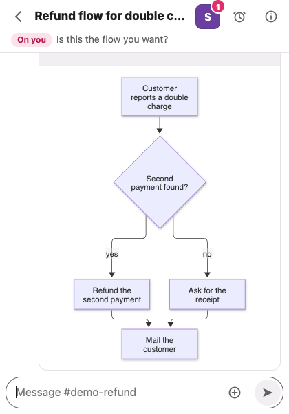
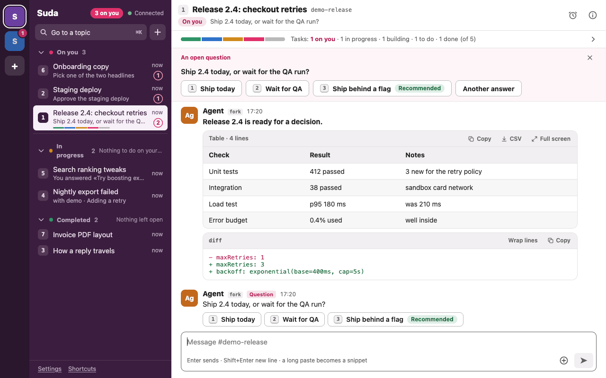

<p align="center">
  
</p>

<p align="center">
  <b><big>话题不是智能体。</big></b><br>
  <i>每个话题一个线程，不管是谁在做。</i>
</p>

<p align="center">
  <b>每个线程都写明现在轮到谁：轮到你、进行中，还是已完成。</b><br>
  <b>任意模型，任意编排。</b>Suda 运行在你自己的机器上，零依赖。
</p>

<p align="center">
  <a href="LICENSE"></a>
  <a href="https://github.com/udiNur/Suda/actions/workflows/ci.yml"></a>
  <a href="https://getsuda.dev/">官网</a> ·
  <a href="#quick-start"></a>
  <a href="CONTRIBUTING.md"></a>
  <a href="SECURITY.md"></a>
  <a href="#how-it-works"></a>
  <a href="#phone-and-desktop"></a>
</p>

<p align="center">
  <a href="README.md">English</a> | <a href="README.he.md">עברית</a> | <a href="README.zh-CN.md">简体中文</a> | <a href="README.ja.md">日本語</a> | <a href="README.ko.md">한국어</a> | <a href="README.pt-BR.md">Português (Brasil)</a> | <a href="README.es.md">Español</a>
</p>

<p align="center">本文为译文，内容以<a href="README.md">英文版 README</a> 为准。</p>

<p align="center">
  <a href="#quick-start">快速开始</a> ·
  <a href="#features">功能</a> ·
  <a href="#for-agents">面向智能体</a> ·
  <a href="#security">安全</a>
</p>

## <a name="quick-start"></a>快速开始

**别再到处找窗口了。直接回复话题。**

```sh
git clone https://github.com/udiNur/Suda.git suda
cd suda
python3 suda/threads.py install   # creates the board in ~/Documents/mds/boards/threads
python3 suda/server.py            # serves it on http://127.0.0.1:8767/threads/suda.html
```

需要 Python 3.9 或更高版本（只用标准库）和一个现代浏览器。支持 macOS 和 Linux。

| 下一步 | 怎么做 |
|---|---|
| **先随便看看** | `python3 docs/demo/demo.py` 会打印一个一次性演示看板的地址。 |
| **接入你的智能体** | 把 [SKILL.md](suda/SKILL.md) 作为 skill 交给它们。它们用 `threads` CLI 写入，见[面向智能体](#for-agents)。 |
| **让塔台得知回复** | 设置 `THREADS_NOTIFY_CMD`，让你的塔台（tower）知道有回复在等，见[配置](#setup)。 |
| **在手机上打开** | 让服务器保持在 127.0.0.1，在它前面放一个网关，见[配置](#setup)。 |

## <a name="features"></a>功能

所有截图都来自一个演示看板，内容均为虚构。

### 每个线程都写明轮到谁

<table>
<tr><td></td><td><b>发布 2.4</b></td><td>批准预发布环境的部署</td></tr>
<tr><td></td><td><b>工单 1042</b></td><td>要退还第二笔付款吗？</td></tr>
<tr><td></td><td><b>夜间导出</b></td><td>正在重试 3 个批次，暂时不需要你处理</td></tr>
<tr><td></td><td><b>成本报告</b></td><td>已完成，摘要在里面</td></tr>
</table>

每个话题一个线程，从第一次请求一直到工作完成。备注是写给不会点开线程的人看的（写“批准预发布环境的部署”，而不是“有更新”）。

<table>
<tr>
<td width="33%" valign="top"><b>线程对应的是话题，不是智能体。</b><br>多个智能体可以在同一个话题里，一个智能体可以在多个话题里，线程也可以完全没有智能体：一张客服工单、一条提醒、一个你欠别人的决定。</td>
<td width="33%" valign="top"><b>任务跟着话题走。</b><br>每个请求都是一项任务，有负责人和状态。属于你的任务单独显示；只要还有未完成的任务，CLI 就拒绝把线程标记为完成（除非强制）。</td>
<td width="33%" valign="top"><b>回答不会和问题走散。</b><br>你的一句“好”会落在它所回答的那个问题的按钮上。每个线程最多五个待回答的问题，各有各的按钮。</td>
</tr>
<tr>
<td valign="top"><b>没轮到你，就不打扰你。</b><br>进展不会通知任何人。<i>On you</i>（轮到你）会发出浏览器通知（在你开启了通知的设备上），除非线程已静音或正处于免打扰时段。也可以让线程稍后再提醒，时间由你定。</td>
<td valign="top"><b>有始有终。</b><br>完成的线程会安静下来，等里面没有任何未结事项后自动归档。</td>
<td valign="top"><b>智能体从已有记录接着做。</b><br>回复送到智能体手里时，带着话题摘要和之前的消息，任务列表一条命令就能拿到。</td>
</tr>
</table>

### 智能体的回答不只是文字

<table>
<tr>
<td width="33%" valign="top"><br><b>图示。</b>Mermaid 流程图、时序图和计划图，支持全屏，点一下就能看源码。</td>
<td width="33%" valign="top"><br><b>Diff。</b>标出改动的词和行号，未改动的行自动折叠，也可以并排显示。</td>
<td width="33%" valign="top"><br><b>图表。</b>把数字显示成图表或表格，可导出 CSV 和 PNG。</td>
</tr>
<tr>
<td valign="top"><br><b>交互页面。</b>一个能实际操作的原型，可在线程内或全屏查看，运行在无网络的沙箱 frame 里。</td>
<td valign="top"><br><b>假设分析卡片。</b>拖动滑块，结果随之变化。</td>
<td valign="top"><br><b>实时状态。</b>一张原地更新的卡片，而不是每一步都发一条新消息。</td>
</tr>
</table>

此外还有：可滚动、可导出的表格，带精确复制按钮的代码，图片，轮播，视频，折叠卡片里的长日志（最大 20 MB），SVG 图，消息内的“下一步”按钮，以及指向 pull request、commit 和其他线程的小标签。`threads help visual` 会列出全部。

### 你的回答也不只是文字

<table>
<tr><td><br><b>点一下就回答。</b>带编号的按钮，并标出智能体推荐的选项。回复会等四秒再发出，按 Esc（或点按钮）即可撤回。</td></tr>
<tr><td><br><b>用 ▶ 批准命令。</b>看清确切的命令再确认。塔台按它的规则检查，在你的机器上运行，并在线程里汇报。浏览器里不运行任何命令。</td></tr>
</table>

<table>
<tr>
<td width="33%" valign="top"><br><b>一张表单，多个决定。</b>分组的复选框，带推荐项和自由填写的备注；必须亲眼看过才能选的选项，用图片块展示。</td>
<td width="33%" valign="top"><br><b>指到原话。</b>选中一段文字再回复：智能体会收到选中的文字，以及它所在的那条消息。</td>
<td width="33%" valign="top"><b>用说的。</b>智能体会收到转写文本和录音（需要 Soniox 密钥和安全页面）。<br><br><b>给它看。</b>带说明文字的图片。日志或文本文件会变成折叠的附件。<br><br><b>拆分。</b>给旁支问题单开一个线程，附上引用和返回链接。<br><br><b>确认对方听到了。</b>你的每条消息下方都有状态：已收到、已接手、已完成。</td>
</tr>
</table>

### 在大量线程之间穿梭

<table>
<tr><td><br><b>⌘K：所有线程，所有命令。</b>搜索、跳到某个线程，或修改一项设置。每个线程都显示上次变动是多久以前。</td></tr>
</table>

<table>
<tr>
<td width="33%" valign="top"><b>斜杠命令。</b><br>在回复框里输入 <code>/</code>：<code>/status</code>、<code>/explain</code> 和 <code>/review</code> 发给智能体；<code>/done</code>、<code>/s</code>（稍后提醒）、<code>/urgent</code>、<code>/mute</code>、<code>/rename</code> 和 <code>/task</code> 作用于线程本身。</td>
<td width="33%" valign="top"><b>一次处理多个线程。</b><br>选中多个线程（Cmd 或 Ctrl 加点击，Shift 加点击选一段范围，手机上长按），然后标为已读、稍后提醒、合并或关闭。</td>
<td width="33%" valign="top"><b>空间及其他。</b><br>空间（例如一个客服空间，有它自己的线程）、紧急线程排在最前、合并、表情回应、浅色和深色主题，以及键盘快捷键（按 <code>?</code> 查看）。</td>
</tr>
</table>

## <a name="why-suda"></a>为什么选择 Suda

**运行智能体很容易，跟上进度才难。**

**“好”，是回答哪一个？**

```text
智能体  预发布环境一切正常。部署 2.4 吗？
智能体  工单 1042：客户付了两次款。要退款吗？
智能体  夜间导出又失败了，3 个批次超时。
你      好
智能体  是同意部署，还是同意退款？
```

我同时运行 10 到 15 个编程智能体。放在一个聊天里，它们的回复会混在一起；每个智能体开一个窗口，你又得到处找是哪个在等你。大多数工具回答的是怎么运行智能体，Suda 回答的是它们需要你做什么。

- **以话题为中心，而不是智能体。** 每个话题一个线程，从第一次请求一直到工作完成，不管有多少智能体参与。
- **一眼看出轮到谁。** 每个线程都标着 On you（轮到你）、Working（进行中）或 Done（已完成），并附一行备注。
- **看得见的回答。** 图示、diff、图表、实时状态和交互页面，直接出现在线程里。
- **点一下就做决定。** 按钮上标着智能体推荐的选项，四秒内可以撤销，在手机上或电脑前都能操作。
- **任意模型，任意编排。** Suda 不启动智能体，也不占用终端：智能体只要能运行 shell 命令就行。
- **属于你，就在你的机器上。** 只用 Python 标准库，零依赖，无需构建，一个 HTML 页面，服务器只监听 127.0.0.1。MIT 许可。

## <a name="how-it-works"></a>工作原理

你在话题里回复。有一个 AI 叫**塔台**（tower），它把每条回复送到处理该话题的智能体手里，智能体则把结果和问题直接发到线程里。塔台只是中间人，不是上司：你永远不需要知道哪个智能体在处理哪个话题。


### 任意模型，任意编排

<table>
<tr>
<td width="33%" valign="top"><b>任意智能体。</b><br>任何能运行 shell 命令的智能体都可以参与：它用 <code>threads</code> CLI 往线程里写。</td>
<td width="33%" valign="top"><b>任意模型。</b><br>不管智能体背后是什么模型，参与的方式都一样。</td>
<td width="33%" valign="top"><b>任意编排。</b><br>Suda 不启动智能体，也不占用终端。它只需要一条命令，用来告诉你的塔台“有回复在等”（<code>THREADS_NOTIFY_CMD</code>）。不配置也不会丢任何东西：塔台随时可以读取 <code>threads pending</code>。</td>
</tr>
</table>

目前只在一套环境上测试过：我们的智能体运行在 [tuios](https://github.com/Gaurav-Gosain/tuios) 里。配合 tuios 和 Claude Code，还有一个可选的 hook（`live_hook.py`），可以显示此刻有哪些智能体正在处理某个线程。

## <a name="phone-and-desktop"></a>手机与桌面

<table>
<tr>
<td width="34%" valign="top" align="center"><br><b>手机优先。</b>一次只显示一个面板。它是一个网页，可以像应用一样添加到主屏幕。</td>
<td width="66%" valign="top" align="center"><br><b>更宽的屏幕。</b>列表和对话并排显示，例如在折叠屏手机的内屏上。</td>
</tr>
</table>

<table>
<tr><td><br><b>桌面。</b>列表在一侧，打开的线程在旁边：这里是一次发布，带任务栏和一个待回答的问题，还有一个运行块、一张图示、一段长日志，以及放在独立空间里的一张客服工单。</td></tr>
</table>

**语言。** 代码和演示都是英文，从左到右。一份翻译就是 `suda/locales/` 里的一张对照表（希伯来语，从右到左，随 `suda/locales/he.json` 提供）：在 `config.json` 里设置 `"lang": "he"`，然后运行 `threads install`。

## <a name="for-agents"></a>面向智能体

智能体做的每件事都通过 `threads` CLI 完成：一个 Python 文件，只用标准库。把 [SKILL.md](suda/SKILL.md) 作为 skill 交给你的智能体，它就是完整的指南。

```sh
threads new release-2-4 "Release 2.4" --state working --note "Running the load test"
threads task add release-2-4 "Load test on staging" --owner fork
threads say release-2-4 --from fork "p95 is 180 ms, was 210 ms." --state working --note "Load test passed, writing the changelog"
threads task set release-2-4 1 done
threads ask release-2-4 "Deploy 2.4 to staging?" --options "Deploy,Wait" --recommended "Deploy" --from fork
```

塔台接收你的回答，再转交下去：

```sh
threads pending                   # the owner's replies that nobody picked up yet
threads ack release-2-4 m3        # picked up (only after the work was handed to an agent)
threads show release-2-4 --json   # also: threads tasks <id>, threads list, threads url [<id>], threads help visual
```

**最后一条命令决定轮到谁。** 智能体写的每条消息都应该带上 `--state` 和一行 `--note`，这样线程才能写明轮到谁。

| 智能体 | 线程变为 |
|---|---|
| 提出问题 | `on-owner` |
| 接手一条回复 | `working` |
| 完成工作 | `done` |
| 写消息时没带状态 | 轮到所有者，作为待阅读的内容（一层保险） |

在代码里，三个角色分别是 **owner**（所有者，看板只为这一个人服务）、**tower**（塔台）和 **agents**（智能体）。页面是单个 HTML 文件（无需构建，不用 CDN），只发出一种请求。每一次改动都经过 `threads.py`，在文件锁之下进行，并有它自己的校验。`server.py` 在回环地址上提供看板。

## <a name="our-setup"></a>我们的配置

这是我们每天在用的组合，可以作为起点。没有它们 Suda 也能用，我们和它们也没有任何关联。

- **[tuios](https://github.com/Gaurav-Gosain/tuios)**：我们的智能体就跑在这里，一个知道每个智能体在做什么的终端窗口管理器。配合它，`live_hook.py` 可以显示此刻有哪些智能体在处理某个线程。
- **[Claude Code](https://github.com/anthropics/claude-code)**：写代码的智能体本身。
- **[Tailscale](https://tailscale.com)**：在任何地方用手机打开 Suda，走你自己的私有网络，服务器仍然只监听 127.0.0.1，前面放一个网关（见配置）。

## <a name="setup"></a>配置

<details>
<summary><b>在手机上打开</b></summary>

让服务器保持在 127.0.0.1，在它前面放一个网关（例如 tailnet 这类私有网络里的 Caddy）。把网关的主机名写进 `SUDA_ALLOWED_HOSTS`，把它的 https 地址写进 `config.json`，页面就能提示你使用这个地址（通知和麦克风需要安全页面）。详见 [SECURITY.md](SECURITY.md)。

</details>

<details>
<summary><b>设置：config.json</b></summary>

这份安装的设置保存在 `~/.config/threads/threads/config.json`，绝不放在仓库里：

```json
{
  "secure_home": "https://suda.example.com",
  "lang": "en",
  "owner_name": "Dana",
  "commands": {"THREADS_NOTIFY_CMD": "your-command-that-mails-the-tower"}
}
```

</details>

<details>
<summary><b>告诉塔台有回复在等：THREADS_NOTIFY_CMD</b></summary>

Suda 通过 `THREADS_NOTIFY_CMD` 联系你的塔台。运行它时会附带一个额外参数：一条说明有回复在等的简短通知（绝不是回复本身）。回复会一直留在 `threads pending` 里，直到有智能体确认收到。

</details>

<details>
<summary><b>定时器：threads sweep</b></summary>

`threads sweep --quiet` 运行时，稍后提醒的线程会到点唤醒，已完成的线程会被归档。用 cron、launchd 或任何调度器每分钟运行一次即可。

</details>

<details>
<summary><b>让服务器一直运行（可选）</b></summary>

服务器只为页面服务：无论它是否运行，智能体都用 `threads` CLI 写入。看板的数据（`suda.db`，SQLite）留在看板的文件夹里，从不对外提供。若要在 macOS 登录时启动服务器，把下面的内容保存为 `~/Library/LaunchAgents/dev.suda.server.plist`（换成你自己的仓库路径），然后运行 `launchctl bootstrap gui/$(id -u) ~/Library/LaunchAgents/dev.suda.server.plist`：

```xml
<?xml version="1.0" encoding="UTF-8"?>
<!DOCTYPE plist PUBLIC "-//Apple//DTD PLIST 1.0//EN" "http://www.apple.com/DTDs/PropertyList-1.0.dtd">
<plist version="1.0">
<dict>
  <key>Label</key><string>dev.suda.server</string>
  <key>ProgramArguments</key>
  <array>
    <string>/usr/bin/python3</string>
    <string>/path/to/suda/suda/server.py</string>
  </array>
  <key>RunAtLoad</key><true/>
  <key>KeepAlive</key><true/>
</dict>
</plist>
```

在 Linux 上，一个 systemd 用户服务也能做到同样的事（`ExecStart=/usr/bin/python3 /path/to/suda/suda/server.py`）。

</details>

<details>
<summary><b>测试看板，以及把 CLI 加入 PATH</b></summary>

默认目录留给你真正的看板：其他任何 `BOARDS_DIR` 都会被当作测试看板，它的私有目录就在旁边。测试看板不会通知任何手机，也不会运行任何外部命令，除非你在环境变量里指定一条替代命令。

还可以把 CLI 加入 PATH：`ln -s "$PWD/suda/threads.py" ~/.local/bin/threads`。

</details>

## <a name="security"></a>安全

- 服务器**只监听 127.0.0.1**，检查 `Host` 请求头（防 DNS rebinding）和每次写入的 `Origin`（防 CSRF），并且只提供它自己的看板目录。
- **浏览器里不运行任何命令。** ▶ 运行块会与为它保存的原文逐字核对（该块的 SHA-256），而且只有塔台会运行它。
- 智能体制作的页面运行在**无网络的沙箱 frame** 里。图示在沙箱 frame 里绘制，再以图片形式显示。
- 私钥、推送订阅、设置和备份都存放在一个**永远不会对外提供的私有目录**里。

详情以及如何报告问题，见 [SECURITY.md](SECURITY.md)。测试先行：测试套件和改动规则见 [CONTRIBUTING.md](CONTRIBUTING.md)。

## <a name="how-it-compares"></a>与其他工具的对比

这些工具我们大多在用或试用过，有些每天都用，它们在各自的领域都做得很好。以下内容基于我们自己的使用体验和它们各自的主页，2026 年 11 月。

| | 围绕什么构建 | Suda 补上了什么 |
|---|---|---|
| **[tuios](https://github.com/Gaurav-Gosain/tuios)** | **窗格。** 一个终端窗口管理器，知道你的智能体在做什么：会话保持存活、智能体状态、智能体之间互发消息。我们的智能体就运行在它里面。 | 在窗格之上，加上话题。 |
| **[herdr](https://github.com/herdrdev/herdr)** | **智能体。** 一个编程智能体的运行时，显示哪个智能体在工作、哪个被卡住，可跨多台机器，也能在手机上看。 | 哪个话题需要我，我们在里面决定了什么？ |
| **Claude Squad、Conductor、Sculptor** | **智能体会话及其代码。** 多个编程智能体并行运行，各自在自己的 worktree 或容器里，并可审查它们的改动。 | 给跨多个智能体、甚至完全没有代码的话题一个归宿。 |
| **OpenHands** | **与智能体的对话。** 一个自托管的控制中心，用于编程智能体和自动化。 | 跨智能体，每个话题一个线程。 |
| **Devin** | **它自己的智能体。** 一个托管的自主工程师，可以在团队聊天里找到它。 | 没有自己的智能体。Suda 与你已经在运行的智能体配合使用。 |
| **带智能体的 Linear** | **Issue。** 一个追踪团队计划内工作的工具，智能体在 issue 的评论里回答。理念上最接近。 | 一个人的实时对话，包括那些永远不会变成 issue 的话题。 |
| **Slack，或任何带机器人的团队聊天** | **频道。** 这正是我们想要的使用感受，Suda 借鉴了它。 | 轮到谁、还有什么没了结，不用给每个智能体配机器人或 token，而且就在你自己的机器上。 |

## <a name="license"></a>许可证

[MIT](LICENSE)
