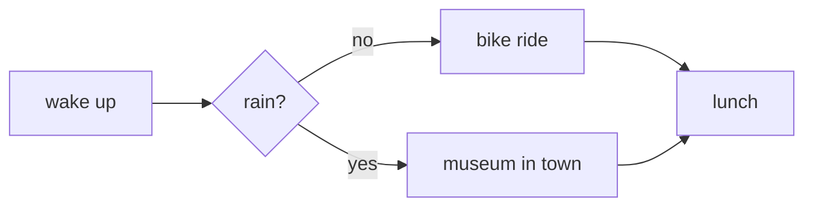

# Plan: a weekend trip to the lake

Two days by the water for six people, with one car and two bikes.

## What to bring

- A tent for four and a tent for two
- Food for five meals, water for the first day
- The first aid kit, sun cream, a torch

## The schedule

| Day | Morning | Afternoon |
|---|---|---|
| Saturday | Drive, set up camp | Swim, walk to the falls |
| Sunday | Bike round the lake | Pack, drive home |

## How the day goes



## The packing list as a script

```python
items = ["tent", "stove", "torch"]
for item in items:
    print("pack", item)  # one line each
```

~~~text
A tilde fence: kept as it is.
~~~

> Leave the site as clean as we found it.

## Open questions

1. Who drives back on Sunday?
2. Do we rent a third bike?
